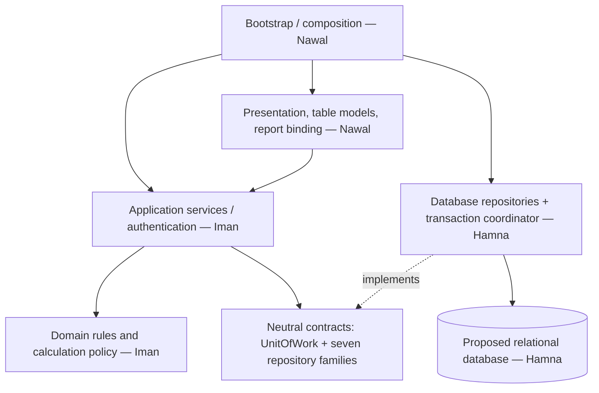

# Team integration guide

**Status: proposed Phase 5 handover, not implemented integration.** Prepared 2026-11-25 against Phase 4 commit `460f737349622fb3e57e8b09025977ebf057a7b6`. Read the [data persistence contract](data-persistence-contract.md) for repository operations, errors, unit-of-work semantics, entity requirements and decisions D1–D8.

## 1. What exists and what does not

Nawal has implemented three Phase 4 separations: product table models/listener notifications, startup composition, and transaction report binding. Evidence and prior test results are in [selected refactorings](../refactoring/selected-refactorings.md) and [refactoring evidence](../refactoring/refactoring-evidence.md).

- [StorePaths](../../reengineered/src/main/java/sg/edu/nus/iss/se24_2ft/unit1/ca/bootstrap/StorePaths.java) resolves paths; [StoreContext.load()](../../reengineered/src/main/java/sg/edu/nus/iss/se24_2ft/unit1/ca/bootstrap/StoreContext.java) constructs six concrete file-backed managers.
- [StoreFeatures](../../reengineered/src/main/java/sg/edu/nus/iss/se24_2ft/unit1/ca/gui/StoreFeatures.java) composes seven panels and manager callbacks; [StoreWindowFactory.create()](../../reengineered/src/main/java/sg/edu/nus/iss/se24_2ft/unit1/ca/gui/StoreWindowFactory.java) constructs the window.
- [ProductTableModels](../../reengineered/src/main/java/sg/edu/nus/iss/se24_2ft/unit1/ca/gui/ProductTableModels.java) owns product/inventory Swing models; [ProductCatalogListener](../../reengineered/src/main/java/sg/edu/nus/iss/se24_2ft/unit1/ca/product/ProductCatalogListener.java) carries synchronous row-index notifications. These notifications precede ProductManager.store(), so they are not durable commit events.
- [TransactionReportBinding.bind()/applyDateRange()](../../reengineered/src/main/java/sg/edu/nus/iss/se24_2ft/unit1/ca/gui/TransactionReportBinding.java) operates on Swing table models and date controls, independently of file loading.
- [StoreApplication.main()](../../reengineered/src/main/java/sg/edu/nus/iss/se24_2ft/unit1/ca/StoreApplication.java) loads staff and shows login before loading StoreContext. Authentication still uses file-backed [StoreKeeperManager.login()](../../reengineered/src/main/java/sg/edu/nus/iss/se24_2ft/unit1/ca/storekeeper/StoreKeeperManager.java).
- [TransactionManager.addTransaction()](../../reengineered/src/main/java/sg/edu/nus/iss/se24_2ft/unit1/ca/transaction/TransactionManager.java) still coordinates separate member/product/history file writes. [ProductManager](../../reengineered/src/main/java/sg/edu/nus/iss/se24_2ft/unit1/ca/product/ProductManager.java) still owns file access despite losing its Swing dependency.

There are no implemented repository ports, database adapters, database schema, unit of work or application-service layer in this codebase. The seven repository families in the contract are proposed interfaces, not classes that can currently be imported or injected. No Phase 5 implementation or tests are produced by this handover.

## 2. Proposed dependency flow

The arrows below are proposed source dependencies. “Implements” means the database adapter depends on the neutral port definition; the application does not depend on its implementation. Results return through method calls; they do not require a reverse dependency from a service to Swing.

The seven families are ProductRepository, CategoryRepository, MemberRepository, DiscountRepository, TransactionRepository, StaffRepository and VendorRepository. UnitOfWork scopes their sessions on one coordinated database transaction; independent repositories must not silently open and commit unrelated transactions.

Presentation, domain rules, money/date policy, service interfaces, repository ports, StorePaths and TransactionReportBinding must remain independent of JDBC, SQL, connection management and database-specific exceptions. Database adapters must remain independent of Swing, panel callbacks and row indices. Neutral DTOs must not expose live manager collections, mutable legacy entities, database proxies, credentials to presentation, or driver objects. Java 8-compatible classes/interfaces can express the proposal; Java record syntax is not a requirement.

## 3. Compatibility work required before wiring

These are future changes, not claims that the current classes already accept the proposed contracts.

| Existing seam / source evidence | Necessary future adaptation | Accountable implementation owner |
|---|---|---|
| [StoreContext.load(StorePaths)](../../reengineered/src/main/java/sg/edu/nus/iss/se24_2ft/unit1/ca/bootstrap/StoreContext.java) constructs managers using filenames | Introduce a reviewed composition path for application services/adapters. Keep any comparison file mode explicit. Never silently fall back to files after database failure. | Nawal |
| [StoreApplication.main()](../../reengineered/src/main/java/sg/edu/nus/iss/se24_2ft/unit1/ca/StoreApplication.java) authenticates before loading other managers | Wire an authentication service backed by StaffRepository before catalog loading. Connection infrastructure may need initialization before login; preserve the login-before-main-window sequence. Do not accidentally combine file authentication and database operations as an undocumented hybrid. | Nawal, consuming Iman's authentication API |
| [StoreFeatures](../../reengineered/src/main/java/sg/edu/nus/iss/se24_2ft/unit1/ca/gui/StoreFeatures.java) calls concrete manager methods through callbacks | Replace callbacks with application-service calls and explicit results/errors. Do not pass repositories directly to panels. Define DTO/service signatures first under D8. | Nawal |
| [ProductTableModels(ProductManager)](../../reengineered/src/main/java/sg/edu/nus/iss/se24_2ft/unit1/ca/gui/ProductTableModels.java) and [ProductCatalogListener](../../reengineered/src/main/java/sg/edu/nus/iss/se24_2ft/unit1/ca/product/ProductCatalogListener.java) consume live products and row indices | Introduce a presentation read-model adapter using detached service snapshots. Map selections to stable product IDs before dispatch. Refresh/notify only after confirmed commit, on the Swing event thread; derive row indices locally. Existing constructors cannot accept a repository unchanged. | Nawal |
| [TransactionReportBinding.bind()/applyDateRange()](../../reengineered/src/main/java/sg/edu/nus/iss/se24_2ft/unit1/ca/gui/TransactionReportBinding.java) expects Date cells and derives initial controls from first/last rows | Supply a compatible history TableModel with documented order/date conversion. Keep inclusive filtering behavior unless D2 explicitly changes it. Do not feed unknown dates as invented exact timestamps or silently change first/last to minimum/maximum behavior. | Nawal |
| [CategoryManager](../../reengineered/src/main/java/sg/edu/nus/iss/se24_2ft/unit1/ca/category/CategoryManager.java), [MemberManager](../../reengineered/src/main/java/sg/edu/nus/iss/se24_2ft/unit1/ca/customer/member/MemberManager.java), [DiscountManager](../../reengineered/src/main/java/sg/edu/nus/iss/se24_2ft/unit1/ca/discount/DiscountManager.java), [TransactionManager](../../reengineered/src/main/java/sg/edu/nus/iss/se24_2ft/unit1/ca/transaction/TransactionManager.java) mix models/rules/files | Extract operation rules into services; expose detached query results. Entity package access and mutable state require explicit mapping/factory decisions, not reflection or indiscriminate public setters for database hydration. | Iman |
| [TransactionManager.addTransaction()](../../reengineered/src/main/java/sg/edu/nus/iss/se24_2ft/unit1/ca/transaction/TransactionManager.java) calls member and product persistence separately | Replace the complete sale coordination path with one UnitOfWork. Never call legacy store() methods in addition to repository writes. | Iman |
| [ProductManager.generatePurchaseOrder()](../../reengineered/src/main/java/sg/edu/nus/iss/se24_2ft/unit1/ca/product/ProductManager.java) accepts understock row indices | Service accepts stable product IDs/versions, rereads understock state and applies the approved immediate replenishment rule. This is not a supplier-order workflow. | Iman |
| [VendorManager.load()](../../reengineered/src/main/java/sg/edu/nus/iss/se24_2ft/unit1/ca/vendor/VendorManager.java) merges names across category files | Import identity/association mapping must preserve category-vendor pairs and report collisions; no new procurement UI is implied. | Hamna |

The current concrete manager constructors and entities are not the target API. Hamna should not implement ProductRepository as a subclass of ProductManager, nor keep its filename-loading constructor as a database integration mechanism. The goal is explicit service composition, not a second persistence path inside existing managers.

## 4. Ownership and deliverable boundaries

The ownership split below assigns one owner to each implementation output. Review and acceptance by another member do not transfer implementation ownership.

| Output / responsibility | Owner | Receives / hands over |
|---|---|---|
| Legacy evidence, architecture dependency rules, current refactoring documentation, bootstrap/presentation integration seams | Nawal | Receives approved service DTOs/error results and adapter construction entry points; hands over wiring and compatible table models. |
| Business/domain policy, service APIs and operation/DTO semantics, checkout orchestration, validation, money/date/loyalty decisions, credential verification policy | Iman | Receives persistence capabilities/errors; hands over API definitions, stable command intent/fingerprint requirements and policy examples. |
| Relational schema, repository adapters, UnitOfWork/isolation/idempotency mechanism, import/reconciliation/rollback tools, data constraints and persistence integration tests | Hamna | Receives approved port/DTO semantics and legacy evidence; hands over adapters, mapping/constraint documentation and reproducible conformance results. |
| Behavior decisions, functional equivalence, integrated acceptance, cutover/recovery approval, final testing and presentation | Shared | Reviews D1–D8 and verifies end-to-end outcomes; no duplicate implementation assignment. |

Nawal documents neutral package/dependency boundaries; Iman finalizes the service-facing port/DTO operation semantics with Hamna's feasibility review. Concrete package and Java interface signatures remain D8 decisions. Hamna owns their database implementations, not discount selection or GUI behavior. Nawal must not silently implement Iman's rules or Hamna's persistence while integrating.

## 5. Checkout integration sequence

This is the proposed normal sale boundary. It deliberately replaces independent file writes; it does not declare unrelated legacy defects approved for correction. Source comparison: [TransactionManager.addTransaction()](../../reengineered/src/main/java/sg/edu/nus/iss/se24_2ft/unit1/ca/transaction/TransactionManager.java), [Transaction](../../reengineered/src/main/java/sg/edu/nus/iss/se24_2ft/unit1/ca/transaction/Transaction.java), [MemberManager.debitLoyaltyPoint()/creditLoyaltyPoint()](../../reengineered/src/main/java/sg/edu/nus/iss/se24_2ft/unit1/ca/customer/member/MemberManager.java) and [reconstructed business rules](../reverse-engineering/business-rules.md).

1. Presentation captures stable user intent and a command ID. Service validates the command and creates the canonical fingerprint agreed in D7. Retries retain the same ID and intent; generated retry timestamps/IDs must not change the fingerprint.
2. Service calls UnitOfWork.write(CommandEnvelope, callback). Within that session it reads the product, member and discount snapshots needed for calculation, validates positive quantities/stock and applies approved eligibility, money and loyalty policy. PUBLIC checkout must not debit a member balance or accept carried redemption state. Such legacy defects require explicit preservation/repair decisions.
3. Service reserves a SaleId through TransactionRepository and constructs the complete new sale/line snapshots. Unit prices for a new sale come from the accepted current pricing policy; missing historic prices are never reconstructed this way. Insert the sale aggregate before sale-linked loyalty movements where foreign keys require it.
4. Service requests version-checked negative stock adjustments and a combined MemberRepository.applyLoyalty operation, where applicable. Debit eligibility uses the pre-credit balance; stock, balance, movement history and first-purchase transition must all be represented. Repository calls must not each commit.
5. Callback returns affected IDs/versions. Hamna's UnitOfWork atomically commits sale header/lines, stock, member/movements and the command receipt. Any known rollback leaves none of them applied. Replaying a committed command returns its stored receipt without rerunning mutations.
6. Only confirmed commit produces UI success and read-model refresh. A failed refresh is a display recovery issue, not permission to repeat checkout. Row-index listener callbacks are not transaction receipts.

A version conflict requires a fresh read and a service decision; do not retry using stale quantities. If changed prices or other terms require user agreement, request reconfirmation under the agreed command policy rather than silently changing the sale. An unknown commit outcome requires lookup/recovery with the original command ID; neither automatic fresh-ID retries nor fallback file writes are safe.

## 6. Other integration sequences

| Workflow | Service responsibility | Repository/session responsibility |
|---|---|---|
| Login | Authentication service verifies submitted credentials using the approved verifier scheme; distinguish incorrect credentials from infrastructure failure. | StaffRepository returns restricted verifier metadata only to authentication, with absent-account versus unavailable outcomes. No password comparison in SQL and no verifier in UI DTOs. |
| Category/product creation | Validate approved identity/fields and format product IDs. | Category insert, or reserve category product sequence then ProductRepository.insert, within one write session; enforce unique keys/references. |
| Member registration | Establish approved initial balance/first-purchase state. | Persist member and any required opening audit entry atomically. An opening snapshot is not an invented historic sale. |
| Discount management/selection | Validate definitions; choose eligibility, maximum percentage and dates. | DiscountRepository persists definitions/returns snapshots; it does not hide selection rules in SQL. |
| Replenishment | Convert selected IDs to current understock products and choose approved order quantities. | Atomic stock adjustment/version checks for the command; no automatic vendor order or receipt is inferred. |
| History/reports | Define query bounds/order and construct presentation/report results using stored snapshots and unknown-field flags. | Read consistent sale/line history; never substitute current product prices for missing historic financial values. |
| Migration | Review mapping decisions and acceptance totals with Shared. | Hamna uses explicit migration-only operations/source keys, no replay of old sales into live balances, no writes to legacy files. |

Refer to [data reconstruction](../reverse-engineering/data-reconstruction.md) and contract section 6 for all eleven file formats, import ordering and rollback requirements. There is no generic edit/delete API or unverified new administrative workflow in this handover.

## 7. Error and recovery handover

| Outcome from contract | Application/presentation response |
|---|---|
| INVALID_INPUT, NOT_FOUND, DUPLICATE_KEY, REFERENCE_CONFLICT | Give actionable operation feedback; retain form intent as appropriate. Do not report success or expose SQL/credentials. |
| VERSION_CONFLICT, INSUFFICIENT_STOCK, INSUFFICIENT_POINTS | Refresh affected data and revalidate; obtain renewed approval when operation terms changed. |
| DATA_INCOMPLETE / DATA_INTEGRITY | Report the incomplete/conflicting record for reconciliation; do not coerce unknowns to zero or bypass constraints. |
| UNAVAILABLE with known rollback | Report failure without claiming a sale exists. Retry only under the agreed command policy. |
| OUTCOME_UNKNOWN | Retain original command ID; recover through lookupCommit and Hamna's reconciliation procedure. NOT_RECORDED is not proof that no competing attempt remains in flight; same-key deduplication still applies. |
| Commit confirmed but UI refresh fails | Recover the committed receipt/read models. Do not repeat mutations. |

Wrong login is an authentication result, not a database exception. Unexpected adapter exceptions become typed persistence failures with private diagnostic causes; they must not be swallowed as printed messages followed by successful UI callbacks.

## 8. Suggested execution order and acceptance gates

1. **Shared decision review:** resolve D1–D8 for the slice being implemented. Record agreed money/date/loyalty/identity/auth examples, known legacy defects and incomplete-history handling. Schema and business behavior must not be frozen by guessing.
2. **Iman API handover:** agree Java 8-compatible service/port DTO signatures and canonical command intent, with Hamna's persistence feasibility review and Nawal's presentation compatibility review.
3. **Parallel work after agreement:** Hamna implements adapters/schema and conformance tests; Iman implements rules/services against neutral ports/fakes; Nawal adapts composition/read models. This describes future team work, not work performed in this task.
4. **Hamna data rehearsal:** isolated import, deterministic re-import, reject/conflict reports, full key/line/vendor association reconciliation, rollback rehearsal. Do not run against or write into legacy/.
5. **Shared integration:** wire explicit target mode and exercise complete workflows, error recovery, history precision and concurrency. Compare agreed behavior with evidence; do not treat known legacy bugs as an unquestioned oracle.
6. **Shared acceptance/cutover:** approve verified backup/recovery and behavior results before live use. Commit/publication requires its own user authorization.

### Required future checks (not executed here)

- Each of the seven repository families: absence versus failure, deterministic snapshots, constraints, duplicates/references and expected-version behavior.
- UnitOfWork: inject faults after sale insert, each stock adjustment, member update, ledger insert and receipt creation; verify complete rollback. Check two concurrent checkouts cannot oversell or over-redeem.
- Retry/recovery: same command/fingerprint is applied once, different intent under the same ID fails, concurrent retries serialize correctly, and unknown outcomes recover without duplicate sales.
- Migration: preserve all source keys/lines/customer tokens and 20 vendor/category associations; quarantine invalid references; represent missing financial/time fields honestly; preserve opening balances without replaying historic sales; verify safe rerun and rollback.
- Integration: normal/invalid/boundary inputs, PUBLIC/member switching, first purchase, zero/nonzero redemption, replenish, receipt/history/report dates and failed post-commit refresh.
- Phase 4 regression: retain relevant inventory, composition and report checks. The recorded suite has 21 tests; previous passing results are evidence only for that phase. It is not repository conformance, full GUI, original JUnit or database coverage. No tests/build were run for this documentation task.

## 9. Evidence and scope

The implementation references above point to the current reengineered copies; the original baseline is untouched under legacy/. For original file records, faulty loader behavior and rules, use [data reconstruction](../reverse-engineering/data-reconstruction.md), [business rules](../reverse-engineering/business-rules.md), [workflow reconstruction](../reverse-engineering/workflow-reconstruction.md) and the [Phase 4 evidence](../refactoring/refactoring-evidence.md).

This handover creates documentation only. Database engine, schema scripts, repository Java files, migration tools and actual integration remain future work. The [contract decision register D1–D8](data-persistence-contract.md#7-open-decisions-and-acceptance-gates) identifies the unresolved decisions and accountable preparers.
