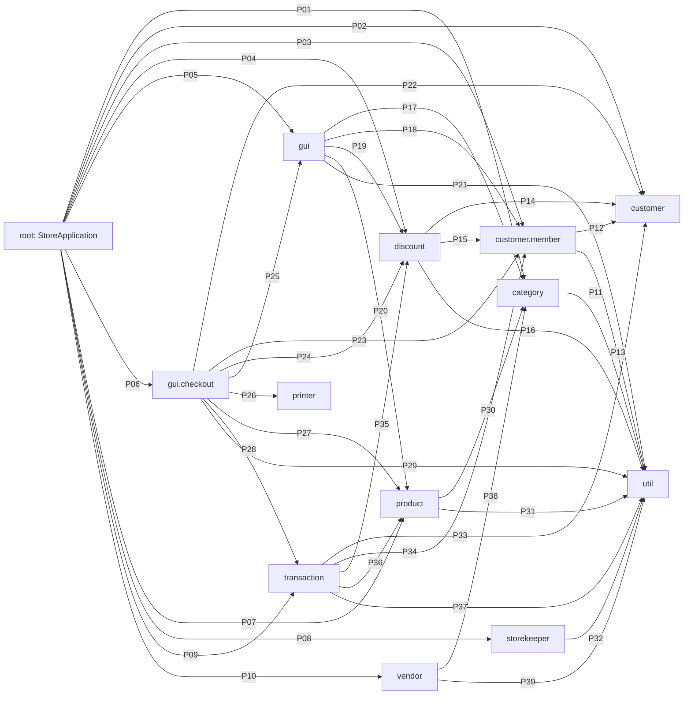
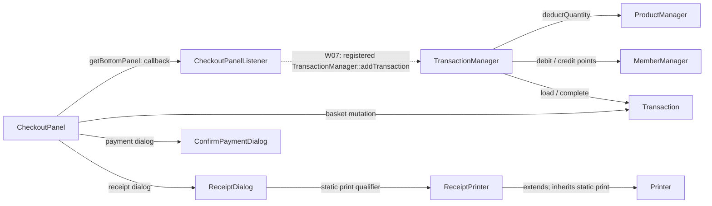
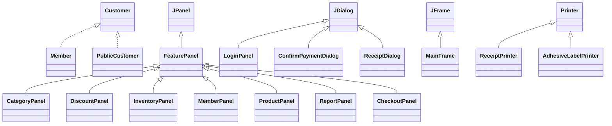
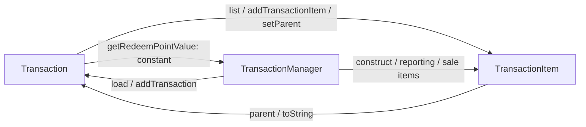

# RePOS: legacy module dependency map

Task 1.2. Analysis date: 2026-11-25. Original baseline commit: `87bee5fed6e44cf87fd91a05de42a6817ae81002`.

## 1. Scope and methodology

This is static analysis of every Java file under `legacy/src/` and `legacy/test/`, cross-checked against the existing inventory. No legacy application, build, test or bundled tool was executed; no dependency was installed. The only deliverable created by this task is this file. Existing inventory documents and the original system remain unchanged.

Actual scope:

| Scope | Packages | Classes | Interfaces | Named top-level types / Java files |
|---|---:|---:|---:|---:|
| Production source | 13 | 33 | 7 | 40 |
| Tests and helper only | 2 | 16 | 0 | 16 |
| Combined, unique | 14 | 49 | 7 | 56 |

The tests share the production root package, while the helper declares the additional package `util`. Therefore package counts are not additive. Four production classes are abstract: CheckoutPanel, FeaturePanel, LoginPanel and Printer. Anonymous subclasses (including table models, renderers, listeners and startup adapters) are inspected as enclosing-class behavior, not counted as extra named classes.

### Dependency definitions

- **A → B:** A's source actively names a project type B in a declaration, field, signature, constructor call, method body, method reference or inheritance relationship. These are source dependencies, not necessarily stored object references or runtime calls.
- **Wiring:** anonymous overrides and method-reference callbacks bind a GUI contract to concrete managers in StoreApplication.main(). Such relationships are recorded separately; they do not mean the panel directly imports a manager.
- **External/API dependency:** Java platform or test-library type use, recorded separately from project-type counts.
- **Shared-data dependency:** multiple operations see/mutate the same domain objects, collections, table model or file. This is described explicitly, not invented as a reverse class edge.
- **Direction:** all flowchart arrows point from dependent/caller to dependency/callee. Class-diagram inheritance arrows point toward the base class/interface.

Method: enumerate declarations/packages/imports; remove comments and string/character literals for a token-level candidate graph; resolve explicit imports, same-package names and the project's wildcard import; inspect signatures, bodies and startup wiring to confirm important relationships. Unused imports and commented-out code are excluded as active dependencies. Method bodies also expose same-package references that import-only analysis misses.

Under that definition, production has **115 distinct directed project-type edges**, including inheritance and constant references, and **39 distinct cross-package edges**. These counts exclude self edges, Java/JUnit types, reflection strings and callback targets not directly named in the enclosing class. They are static source fan-out/fan-in measures, not compiler-produced bytecode dependencies, dynamic dispatch counts or invocation frequencies.

No compiler or full Java AST/type-resolution tool was run. Candidate edges were checked against actual source; runtime paths, concurrency outcomes and build success remain unverified. Compile-time constants may be inlined, so a source cycle is not automatically a class-loading cycle or infinite recursion.

## 2. Existing packages and modules

The production prefix is `sg.edu.nus.iss.se24_2ft.unit1.ca`. Names below are actual package suffixes, not claimed architectural layers.

| Package suffix | Named types | Current responsibilities |
|---|---:|---|
| `(root)` | 1 | Startup and concrete object wiring. |
| `category` | 2 | Category model/registry plus file access and Swing model. |
| `customer` | 2 | Customer interface and public-customer representation. |
| `customer.member` | 2 | Member state, loyalty operations, persistence and table model. |
| `discount` | 2 | Discount definition, eligibility, storage and table model. |
| `gui` | 14 | Swing containers/forms/reports and feature callbacks. |
| `gui.checkout` | 4 | Basket/payment/receipt interaction and completion callback. |
| `printer` | 3 | Console-output base and partial printer subclasses. |
| `product` | 2 | Product state, category lookup, stock operations, storage and table models. |
| `storekeeper` | 2 | Plaintext staff records and file-backed credential comparison. |
| `transaction` | 3 | Sale/entity/item state, orchestration, storage and Swing reporting. |
| `util` | 1 | Shared parsing/formatting/date helpers. |
| `vendor` | 2 | Vendor/category associations and file loading. |

Tests declare `sg.edu.nus.iss.se24_2ft.unit1.ca` in 15 classes; `legacy/test/util/TestUtil.java` declares `util`. No package declaration establishes separation between business logic, file access and Swing presentation: individual manager classes contain all three.

## 3. Production class responsibilities and complete outgoing project-type table

C-identifiers are evidence references: every C-id resolves to the exact source path in this table. Simple type names are unique among the inspected files. “None” means no other named project type under the defined metric, not no Java API dependencies. Each listed destination has its own source row.

| ID | Class / interface | Exact source path | Responsibilities / relevant methods | Direct outgoing project-type dependencies |
|---|---|---|---|---|
| C01 | AdhesiveLabelPrinter (class) | `legacy/src/sg/edu/nus/iss/se24_2ft/unit1/ca/printer/AdhesiveLabelPrinter.java` | getTag(): incomplete label-printer subclass. | Printer |
| C02 | Category (class) | `legacy/src/sg/edu/nus/iss/se24_2ft/unit1/ca/category/Category.java` | Category(): requested ID/name; setId(), toString(). | None |
| C03 | CategoryManager (class) | `legacy/src/sg/edu/nus/iss/se24_2ft/unit1/ca/category/CategoryManager.java` | Constructor loads categories; addCategory(), getCategory(), getTableModel(), store(). | Category, Util |
| C04 | CategoryPanel (class) | `legacy/src/sg/edu/nus/iss/se24_2ft/unit1/ca/gui/CategoryPanel.java` | Constructor builds add/reset form; addCategoryPanelListener(), setTableModel(). | Category, CategoryPanelListener, FeaturePanel |
| C05 | CategoryPanelListener (interface) | `legacy/src/sg/edu/nus/iss/se24_2ft/unit1/ca/gui/CategoryPanelListener.java` | addCategoryRequested(Category) callback contract. | Category |
| C06 | CheckoutPanel (class) | `legacy/src/sg/edu/nus/iss/se24_2ft/unit1/ca/gui/checkout/CheckoutPanel.java` | getItemPanel()/getBottomPanel(): basket, member selection, payment, completion, receipt and stock alert; abstract lookups. | Customer, Member, Discount, FeaturePanel, CheckoutPanelListener, ConfirmPaymentDialog, ReceiptDialog, Product, Transaction, TransactionItem, Util |
| C07 | CheckoutPanelListener (interface) | `legacy/src/sg/edu/nus/iss/se24_2ft/unit1/ca/gui/checkout/CheckoutPanelListener.java` | addTransactionRequested(Transaction) callback contract. | Transaction |
| C08 | ConfirmPaymentDialog (class) | `legacy/src/sg/edu/nus/iss/se24_2ft/unit1/ca/gui/checkout/ConfirmPaymentDialog.java` | Constructor/getPaymentPanel(): collect payment/redemption and confirmation; balanceChanged(). | Customer, Member, Discount, Transaction, TransactionManager, Util |
| C09 | Customer (interface) | `legacy/src/sg/edu/nus/iss/se24_2ft/unit1/ca/customer/Customer.java` | getId() customer contract. | None |
| C10 | Discount (class) | `legacy/src/sg/edu/nus/iss/se24_2ft/unit1/ca/discount/Discount.java` | isDiscountAvailable(): clock-based availability; getters, toString(). | Util |
| C11 | DiscountManager (class) | `legacy/src/sg/edu/nus/iss/se24_2ft/unit1/ca/discount/DiscountManager.java` | Constructor loads definitions; addDiscount(), getMaxDiscount(), getTableModel(), store(). | Customer, Member, Discount, Util |
| C12 | DiscountPanel (class) | `legacy/src/sg/edu/nus/iss/se24_2ft/unit1/ca/gui/DiscountPanel.java` | newDiscountPanel(): definition entry; setTableModel(), listener registration. | Discount, DiscountPanelListener, FeaturePanel, Util |
| C13 | DiscountPanelListener (interface) | `legacy/src/sg/edu/nus/iss/se24_2ft/unit1/ca/gui/DiscountPanelListener.java` | addDiscountRequested(Discount) callback contract. | Discount |
| C14 | FeaturePanel (class) | `legacy/src/sg/edu/nus/iss/se24_2ft/unit1/ca/gui/FeaturePanel.java` | Abstract JPanel base forwarding constructors. | None |
| C15 | InventoryPanel (class) | `legacy/src/sg/edu/nus/iss/se24_2ft/unit1/ca/gui/InventoryPanel.java` | Constructor builds selected-row replenishment/confirmation action; setTableModel(). | FeaturePanel, InventoryPanelListener |
| C16 | InventoryPanelListener (interface) | `legacy/src/sg/edu/nus/iss/se24_2ft/unit1/ca/gui/InventoryPanelListener.java` | purchaseOrderRequested(List<Integer>) callback contract. | None |
| C17 | LoginPanel (class) | `legacy/src/sg/edu/nus/iss/se24_2ft/unit1/ca/gui/LoginPanel.java` | Modal login; getButtonPanel() invokes abstract login(); isSuccess(). | None |
| C18 | MainFrame (class) | `legacy/src/sg/edu/nus/iss/se24_2ft/unit1/ca/gui/MainFrame.java` | JFrame/tab container; addFeaturePanel(String, FeaturePanel). | FeaturePanel |
| C19 | Member (class) | `legacy/src/sg/edu/nus/iss/se24_2ft/unit1/ca/customer/member/Member.java` | Customer implementation; identity, loyalty mutations, toString(). | Customer |
| C20 | MemberManager (class) | `legacy/src/sg/edu/nus/iss/se24_2ft/unit1/ca/customer/member/MemberManager.java` | Constructor loads members; addMember(), debitLoyaltyPoint(), creditLoyaltyPoint(), getTableModel(), store(). | Member, Util |
| C21 | MemberPanel (class) | `legacy/src/sg/edu/nus/iss/se24_2ft/unit1/ca/gui/MemberPanel.java` | Member add/list controls; addMemberPaneListener(), setTableModel(). | Member, FeaturePanel, MemberPanelListener |
| C22 | MemberPanelListener (interface) | `legacy/src/sg/edu/nus/iss/se24_2ft/unit1/ca/gui/MemberPanelListener.java` | addMemberRequested(Member) callback contract. | Member |
| C23 | Printer (class) | `legacy/src/sg/edu/nus/iss/se24_2ft/unit1/ca/printer/Printer.java` | Constructor increments shared count; static print() writes System.out; abstract getTag(). | None |
| C24 | Product (class) | `legacy/src/sg/edu/nus/iss/se24_2ft/unit1/ca/product/Product.java` | Category-associated stock/price record; isUnderstock(), restock(), deductQuantity(), toString(). | Category |
| C25 | ProductManager (class) | `legacy/src/sg/edu/nus/iss/se24_2ft/unit1/ca/product/ProductManager.java` | Constructor loads category-linked products; addProduct(), deductQuantity(), generatePurchaseOrder(), two table models, store(). | Category, CategoryManager, Product, Util |
| C26 | ProductPanel (class) | `legacy/src/sg/edu/nus/iss/se24_2ft/unit1/ca/gui/ProductPanel.java` | newProductPanel(): parse product fields and dispatch add; setTableModel(), resetFields(). | FeaturePanel, ProductPanelListener, Product, Util |
| C27 | ProductPanelListener (interface) | `legacy/src/sg/edu/nus/iss/se24_2ft/unit1/ca/gui/ProductPanelListener.java` | addProductRequested(String, Product) callback contract. | Product |
| C28 | PublicCustomer (class) | `legacy/src/sg/edu/nus/iss/se24_2ft/unit1/ca/customer/PublicCustomer.java` | Shared Customer instance; getInstance(), getId() returns PUBLIC. | Customer |
| C29 | ReceiptDialog (class) | `legacy/src/sg/edu/nus/iss/se24_2ft/unit1/ca/gui/checkout/ReceiptDialog.java` | getReceiptPanel()/getReceiptText(): receipt rendering; setVisible() requests console output. | Customer, Member, Discount, ReceiptPrinter, Product, Transaction, TransactionItem, TransactionManager, Util |
| C30 | ReceiptPrinter (class) | `legacy/src/sg/edu/nus/iss/se24_2ft/unit1/ca/printer/ReceiptPrinter.java` | getTag(): incomplete subclass; receipt code qualifies inherited static print() with this type. | Printer |
| C31 | ReportPanel (class) | `legacy/src/sg/edu/nus/iss/se24_2ft/unit1/ca/gui/ReportPanel.java` | Four report tables; createTransactionReportPanel() filters dates; set*TableModel() receives models. | FeaturePanel, Util |
| C32 | StoreApplication (class) | `legacy/src/sg/edu/nus/iss/se24_2ft/unit1/ca/StoreApplication.java` | main(): environment paths, login, manager/panel construction, callbacks, shared table models, window lifecycle. | CategoryManager, Customer, Member, MemberManager, Discount, DiscountManager, CategoryPanel, DiscountPanel, InventoryPanel, LoginPanel, MainFrame, MemberPanel, ProductPanel, ReportPanel, CheckoutPanel, Product, ProductManager, StoreKeeperManager, TransactionManager, VendorManager |
| C33 | StoreKeeper (class) | `legacy/src/sg/edu/nus/iss/se24_2ft/unit1/ca/storekeeper/StoreKeeper.java` | Constructor/getName()/getPassword(): plaintext staff record. | None |
| C34 | StoreKeeperManager (class) | `legacy/src/sg/edu/nus/iss/se24_2ft/unit1/ca/storekeeper/StoreKeeperManager.java` | Constructor loads staff file; login() compares credentials. | StoreKeeper, Util |
| C35 | Transaction (class) | `legacy/src/sg/edu/nus/iss/se24_2ft/unit1/ca/transaction/Transaction.java` | Basket/entity state; addTransactionItem(), totals/payment/points, table model, toStringStream(). | Customer, Discount, Product, TransactionItem, TransactionManager, Util |
| C36 | TransactionItem (class) | `legacy/src/sg/edu/nus/iss/se24_2ft/unit1/ca/transaction/TransactionItem.java` | Product/quantity/parent references; setParent(), getParent(), toString() builds persisted line. | Customer, PublicCustomer, Product, Transaction, Util |
| C37 | TransactionManager (class) | `legacy/src/sg/edu/nus/iss/se24_2ft/unit1/ca/transaction/TransactionManager.java` | Constructor loads history; addTransaction() coordinates points/stock/IDs; report rows and store(). | Customer, PublicCustomer, Member, MemberManager, Product, ProductManager, Transaction, TransactionItem, Util |
| C38 | Util (class) | `legacy/src/sg/edu/nus/iss/se24_2ft/unit1/ca/util/Util.java` | Static CSV/date/number/money helpers and shared DATE_FORMAT. | None |
| C39 | Vendor (class) | `legacy/src/sg/edu/nus/iss/se24_2ft/unit1/ca/vendor/Vendor.java` | Name/description/category list; addCategory(), getCategoryList(). | Category |
| C40 | VendorManager (class) | `legacy/src/sg/edu/nus/iss/se24_2ft/unit1/ca/vendor/VendorManager.java` | Constructor/load(): category-specific vendor files; getVendorListByCategoryId(). | Category, CategoryManager, Util, Vendor |

The callbacks' target managers are supplied in C32/StoreApplication.main(); see section 5 for exact bindings. In particular, ReportPanel accepts Java TableModel objects and does not directly name any manager, and CheckoutPanel resolves products/members/discounts through abstract methods rather than importing their managers.

## 4. Package-to-package dependencies

Each row is a distinct active cross-package source edge. The witness is one actual class pair from section 3; it is sufficient evidence for that edge, not a claim that it is the only pair. Both source paths resolve through the listed C-identifiers.

| Edge | Dependent package suffix | Dependency package suffix | Source witness (dependent → type used) |
|---|---|---|---|
| P01 | `(root)` | `category` | StoreApplication (C32) → CategoryManager (C03) |
| P02 | `(root)` | `customer` | StoreApplication (C32) → Customer (C09) |
| P03 | `(root)` | `customer.member` | StoreApplication (C32) → Member (C19) |
| P04 | `(root)` | `discount` | StoreApplication (C32) → Discount (C10) |
| P05 | `(root)` | `gui` | StoreApplication (C32) → CategoryPanel (C04) |
| P06 | `(root)` | `gui.checkout` | StoreApplication (C32) → CheckoutPanel (C06) |
| P07 | `(root)` | `product` | StoreApplication (C32) → Product (C24) |
| P08 | `(root)` | `storekeeper` | StoreApplication (C32) → StoreKeeperManager (C34) |
| P09 | `(root)` | `transaction` | StoreApplication (C32) → TransactionManager (C37) |
| P10 | `(root)` | `vendor` | StoreApplication (C32) → VendorManager (C40) |
| P11 | `category` | `util` | CategoryManager (C03) → Util (C38) |
| P12 | `customer.member` | `customer` | Member (C19) → Customer (C09) |
| P13 | `customer.member` | `util` | MemberManager (C20) → Util (C38) |
| P14 | `discount` | `customer` | DiscountManager (C11) → Customer (C09) |
| P15 | `discount` | `customer.member` | DiscountManager (C11) → Member (C19) |
| P16 | `discount` | `util` | Discount (C10) → Util (C38) |
| P17 | `gui` | `category` | CategoryPanel (C04) → Category (C02) |
| P18 | `gui` | `customer.member` | MemberPanel (C21) → Member (C19) |
| P19 | `gui` | `discount` | DiscountPanel (C12) → Discount (C10) |
| P20 | `gui` | `product` | ProductPanel (C26) → Product (C24) |
| P21 | `gui` | `util` | DiscountPanel (C12) → Util (C38) |
| P22 | `gui.checkout` | `customer` | CheckoutPanel (C06) → Customer (C09) |
| P23 | `gui.checkout` | `customer.member` | CheckoutPanel (C06) → Member (C19) |
| P24 | `gui.checkout` | `discount` | CheckoutPanel (C06) → Discount (C10) |
| P25 | `gui.checkout` | `gui` | CheckoutPanel (C06) → FeaturePanel (C14) |
| P26 | `gui.checkout` | `printer` | ReceiptDialog (C29) → ReceiptPrinter (C30) |
| P27 | `gui.checkout` | `product` | CheckoutPanel (C06) → Product (C24) |
| P28 | `gui.checkout` | `transaction` | CheckoutPanel (C06) → Transaction (C35) |
| P29 | `gui.checkout` | `util` | CheckoutPanel (C06) → Util (C38) |
| P30 | `product` | `category` | Product (C24) → Category (C02) |
| P31 | `product` | `util` | ProductManager (C25) → Util (C38) |
| P32 | `storekeeper` | `util` | StoreKeeperManager (C34) → Util (C38) |
| P33 | `transaction` | `customer` | Transaction (C35) → Customer (C09) |
| P34 | `transaction` | `customer.member` | TransactionManager (C37) → Member (C19) |
| P35 | `transaction` | `discount` | Transaction (C35) → Discount (C10) |
| P36 | `transaction` | `product` | Transaction (C35) → Product (C24) |
| P37 | `transaction` | `util` | Transaction (C35) → Util (C38) |
| P38 | `vendor` | `category` | Vendor (C39) → Category (C02) |
| P39 | `vendor` | `util` | VendorManager (C40) → Util (C38) |

### Actual production package graph

This diagram contains all 13 packages and all 39 edges from the package table. Same-package references are deliberately absent here; section 8 shows the transaction-class cycle that this graph cannot reveal.

## 5. Constructor, callback and operation dependencies

These are source-confirmed operation relationships. A wiring row is not an extra direct type edge in the class/package metrics. StoreApplication owns concrete construction, while listeners/anonymous overrides provide some existing indirection.

### Startup bindings

Every row is evidenced by `legacy/src/sg/edu/nus/iss/se24_2ft/unit1/ca/StoreApplication.java`, `main()`, together with the listed receiving methods/classes.

| ID | Source-side contract / operation | Concrete target and reason | What the panel directly depends on |
|---|---|---|---|
| W01 | LoginPanel anonymous override login(username, password) | StoreKeeperManager.login(); manager constructed with data/Storekeepers.dat | LoginPanel has an abstract login() method, not a StoreKeeperManager import. |
| W02 | CategoryPanel.addCategoryPanelListener() / CategoryPanelListener.addCategoryRequested() | CategoryManager::addCategory | Category plus CategoryPanelListener. |
| W03 | MemberPanel.addMemberPaneListener() / MemberPanelListener.addMemberRequested() | MemberManager::addMember | Member plus MemberPanelListener. |
| W04 | ProductPanel.addProductPanelListener() / ProductPanelListener.addProductRequested(cid, product) | Lambda resolves CategoryManager.getCategory(cid), then ProductManager.addProduct(category, product) | Product plus ProductPanelListener; category-manager lookup is in startup lambda. |
| W05 | DiscountPanel.addDiscountPanelListener() / DiscountPanelListener.addDiscountRequested() | DiscountManager::addDiscount | Discount plus void callback; manager's boolean duplicate result is discarded by this binding. |
| W06 | InventoryPanel.addInventoryPanelListener() / InventoryPanelListener.purchaseOrderRequested(indices) | ProductManager::generatePurchaseOrder | List of selected table-row indices plus InventoryPanelListener. |
| W07 | CheckoutPanel.addCheckoutPanelListener() / CheckoutPanelListener.addTransactionRequested(transaction) | TransactionManager::addTransaction | Transaction plus CheckoutPanelListener; listener is bound by startup. |
| W08 | CheckoutPanel anonymous overrides getProduct(), getMember(), getDiscount() | ProductManager.getProduct(), MemberManager.getMember(), DiscountManager.getMaxDiscount() | Abstract lookups and domain types. |
| W09 | Feature-panel setTableModel() and ReportPanel.set*TableModel() | Cached models from category/product/member/discount/transaction managers; inventory uses ProductManager.getUnderstockTableModel() | Java TableModel; concrete manager is chosen by startup. |

VendorManager is constructed with a directory and CategoryManager in main(), causing immediate loading, but that variable has no later use in startup. Source/test reference searches find no vendor selection in a feature panel. This is **disconnected feature integration**, not a claim that vendor loading never executes.

### Important coupling decisions

Each class reference below resolves to its exact path in section 3; methods identify why the dependency exists. “Remain”, “invert” and “remove” are preliminary future recommendations, not changes made by this task.

| ID | Actual dependency and method evidence | Necessary relationship or avoidable coupling? | Testing / maintenance consequence | Preliminary disposition |
|---|---|---|---|---|
| D01 | StoreApplication (C32).main() constructs all managers and panels; ProductManager receives CategoryManager, VendorManager receives CategoryManager, TransactionManager receives ProductManager/MemberManager. | Some concrete construction is necessary in startup; embedded data paths, modal login and lifecycle wiring make the whole main() unsuitable as a unit-test entry point. | Integration setup must supply files and GUI; concrete setup changes affect one central method. | **Remain** as a thin composition/bootstrap responsibility; move use-case decisions/configuration out of it later. |
| D02 | Panel listener invocations W02-W07; CategoryPanelListener (C05), MemberPanelListener (C22), ProductPanelListener (C27), DiscountPanelListener (C13), InventoryPanelListener (C16), CheckoutPanelListener (C07). | Indirection is useful and already exists. Carrying mutable entities or table indices and dropping a result are avoidable contract choices. | Can supply callback doubles, but contract changes propagate through panel/startup/manager; duplicate-discount feedback is lost. | **Remain/adapt** input/output contracts; bind them to application operations rather than file-owning managers. |
| D03 | CheckoutPanel (C06) abstract lookups, implemented in W08 by StoreApplication (C32). | Looking up products/members and discount eligibility is necessary; knowing concrete manager classes in the panel is already avoided. | Some substitution is possible today, but anonymous-class setup and mutable returned objects keep coordination tightly connected. | **Remain/invert further** through explicit query/use-case contracts; do not describe existing panel code as directly importing managers. |
| D04 | CheckoutPanel (C06).getBottomPanel() chooses discount, opens ConfirmPaymentDialog, sets Date, calls completion callback, opens ReceiptDialog, reads understock products, resets Transaction. getItemPanel() creates TransactionItem. | UI interactions belong here; sequencing sale business operations inside the panel is avoidable. | Must exercise Swing to verify the complete user path; exceptions after confirmation can interrupt UI flow. | **Move coordination** toward application/service responsibility; presentation should request operations and display results. |
| D05 | ConfirmPaymentDialog (C08).getPaymentPanel() reads Member balance, computes max redeem points, calls Transaction.setRedeemPoint()/setPayment(); both payment/receipt dialogs name TransactionManager constants. | Input/display is necessary; duplicated eligibility/conversion reasoning and dependence on a concrete manager for policy are avoidable. | UI and business rules can drift; testing point boundaries currently reaches dialog construction. | **Remove manager-policy coupling**; domain/application policy should produce amounts/limits consumed by UI. |
| D06 | Transaction (C35).getRedeemPointValue() reads TransactionManager.POINT_TO_DOLLAR; TransactionManager (C37).load()/addTransaction() constructs and mutates Transaction. | Transaction-to-policy knowledge is necessary; domain object-to-file-owning manager direction is avoidable. | Creates a source dependency cycle and binds model semantics to orchestration/storage class. | **Remove/invert** reverse dependency: put verified conversion policy with domain rules or supply it explicitly. |
| D07 | Transaction (C35) holds items and addTransactionItem() calls setParent(this); TransactionItem (C36) holds parent and toString() reads parent ID/customer/date. | Sale-to-line relationship is necessary; mandatory back-reference solely to produce persisted rows is avoidable. | Item serialization needs a completed parent; standalone line reuse/testing is awkward. | **Retain association if justified**, but move persistence mapping out of item; evaluate removing parent reference rather than assuming all bidirectional associations are defects. |
| D08 | TransactionManager (C37).addTransaction() calls MemberManager.debitLoyaltyPoint()/creditLoyaltyPoint() and ProductManager.deductQuantity(); load() uses their lookups. | Sale completion must coordinate stock and loyalty; dependency on concrete managers with immediate writes is avoidable. | Difficult to substitute failures or ensure coherent updates; each call can modify a separate file. | **Invert** to explicit stock/member/storage contracts and a defined completion boundary in the application layer; actual storage mechanism remains undecided. |
| D09 | ProductManager (C25) constructor stores CategoryManager; load() resolves categories; addProduct() takes Category; Product (C24) holds Category. | Product-category relationship is necessary; using a file-owning category registry during loading is an adapter/lookup concern. | Product load needs category files/manager initialization order; malformed references are skipped or fail. | **Retain domain relationship**, adapt/invert lookup for persistence/service responsibilities. |
| D10 | VendorManager (C40) constructor/load() calls CategoryManager.getCategory() and creates Vendor objects; Vendor (C39).addCategory() stores associations. | Vendor-category association is evidenced; concrete category manager/file naming dependency is avoidable outside data adapters. | Loading needs directory plus categories; same-name vendors share objects across category lists. | **Retain verified associations**, isolate filename/identity resolution; do not invent vendor-order operations. |
| D11 | DiscountManager (C11).getMaxDiscount(Customer) uses instanceof Member, loyalty balance and MEMBER_FIRST/MEMBER_SUBSEQ codes. Discount (C10).isDiscountAvailable() uses current time and Util.addDate(). | Eligibility needs customer/date facts; hard-coded concrete type/sentinel/code interpretation can be isolated as policy. | Adding customer types or testing dates affects manager/model behavior; time cannot currently be supplied by callers. | **Retain verified rules**, isolate policy and supply time/eligibility facts rather than moving business rules into utilities. |
| D12 | CategoryManager, ProductManager, MemberManager, DiscountManager, TransactionManager: constructor → load() → Files.lines(); store() → Files.write(). StoreKeeperManager loads staff; VendorManager lists/reads vendor files. | Durable data access is necessary; direct file APIs in classes also enforcing rules and presenting tables are avoidable. | Construction performs I/O; tests need real fixtures and paths; checked I/O failures are printed rather than returned as operation outcomes. | **Invert/extract** persistence behind application/domain-facing contracts; retain actual text-file mapping as comparison adapter evidence. |
| D13 | CategoryManager, ProductManager, MemberManager, DiscountManager, TransactionManager and Transaction implement getTableModel(); ProductManager also getUnderstockTableModel(), using anonymous AbstractTableModel subclasses and fireTable*(). | Table presentation is required by current Swing UI; Swing types inside rule/storage owners are avoidable. | Presentation and data mutation must evolve together; table event ordering leaks into business tests. | **Remove Swing dependency from domain/services**; keep table adapters and rendering in presentation responsibility. |
| D14 | ProductManager (C25).deductQuantity() can fire understockTableModel.fireTableRowsInserted() when that field is null; W09 initializes it in normal startup. | Inventory mutation is necessary; requiring a view model to be initialized before a valid mutation is avoidable. | Standalone use has a null-dereference path; normal startup initialization mitigates this specific case. | **Remove view-initialization precondition** from stock operation; retain/update UI through a separate adapter contract later. |
| D15 | Transaction (C35).toStringStream(), TransactionItem (C36).toString(), entity CSV toString() methods, managers' Util.splitCsv() calls. | Data formatting is needed at the file boundary; tying domain to storage row layout/default parsing is avoidable. | Changing delimiters/columns affects entities and managers; sale item mapping depends on parent and current products. | **Move mapping/parsing** toward persistence adapters; retain domain invariants independently. |
| D16 | ReportPanel (C31).set*TableModel() receives the same cached models used by other features through W09; transaction model rows in TransactionManager read live Product/Customer objects. | Reporting needs queries/results; reusing live mutable operational model objects is a coupling choice. | Changes in records/events affect multiple views; report-model fidelity depends on loader state. | **Adapt** toward report query/results plus presentation table adapters; do not claim ReportPanel directly calls a manager. |
| D17 | ReceiptDialog (C29).setVisible() calls ReceiptPrinter.print(getReceiptText()); ReceiptPrinter (C30) inherits static print() from Printer (C23), which calls System.out.println(). | Receipt output is real; performing output as a side effect of dialog visibility and using a static superclass method are avoidable. | Showing a view writes console output; substituting printer subclasses does not override that static method. | **Invert/adapt** output behind an output contract if required; keep current console receipt as comparison, not assumed hardware printing. |
| D18 | CategoryManager.getCategoryList(), ProductManager.getProductList(), DiscountManager.getDiscountList(), Transaction.getTransactionItemList(), VendorManager.getVendorListByCategoryId() return internal lists. MemberManager.getMemberList()/Vendor.getCategoryList() copy lists but retain element references. | Sharing identifiers/data is necessary; exposing mutable collections/objects is generally avoidable. | External mutation can bypass maps, validation, file writes or notifications; list copies are shallow. | **Remove unintended mutation paths** with explicit operations/read views after behavior is characterized. |
| D19 | Util (C38).DATE_FORMAT is a public static final SimpleDateFormat; PublicCustomer (C28).getInstance() returns one shared instance; Printer (C23) has static count; TransactionManager's conversion constants are shared. | These forms of shared state differ: public-customer identity is effectively read-only, constants immutable, formatter mutable, printer count mutable. | Shared formatter settings/state can couple parsing and GUI fields; concurrency concerns are hypothetical until runtime use is verified. | **Retain justified immutable identity/constants**, isolate mutable formatter/time/output state; do not call every singleton a defect. |
| D20 | Package-private Category.setId(), Member point mutators, Product.setId()/setCategory()/restock()/deductQuantity(), Transaction.setId()/setCreditPoint(), TransactionItem.setParent()/addQuantity() are called from same-package managers/entities. | Restricted mutation helps invariants, but moving whole classes to different packages would break existing access boundaries. | Mechanical package relocation is insufficient; mutation/creation contracts must be designed and tested. | **Retain invariant intent**, adapt operation/factory boundaries deliberately during later restructuring. |

D12/D13/D18 expand to the individually named owners in section 3, each with an exact path. They group repeated dependency shapes rather than invent a common superclass.

### Actual checkout call and binding slice

This is a selected view, not a new architecture. Solid arrows are source dependencies/calls from section 3 or D08/D17. The dashed W07 arrow is a registered method-reference target: the listener interface itself does not name TransactionManager. The inheritance edge is labeled to prevent interpreting it as an operation call.

The current path returns after calling completion listeners and then shows receipt/understock UI. This diagram does not assert successful disk writes or error recovery.

## 6. Inheritance and interface implementations

These are declarations in the class registry, not inferred patterns.

| Relationship | Source declaration evidence | Interpretation |
|---|---|---|
| Member → Customer; PublicCustomer → Customer | Member.java / PublicCustomer.java: implements Customer | Existing domain identity abstraction; retain while rules are verified. |
| CategoryPanel, DiscountPanel, InventoryPanel, MemberPanel, ProductPanel, ReportPanel, CheckoutPanel → FeaturePanel | Each class declaration: extends FeaturePanel | Shared Swing panel base. |
| FeaturePanel → javax.swing.JPanel | FeaturePanel declaration | Swing inheritance reaches all feature panels. |
| LoginPanel, ConfirmPaymentDialog, ReceiptDialog → javax.swing.JDialog | Each class declaration | Modal/input/output window responsibility. |
| MainFrame → javax.swing.JFrame | MainFrame declaration | Main application window. |
| ReceiptPrinter, AdhesiveLabelPrinter → Printer | Each class declaration: extends Printer | Subclasses override getTag(), returning null; active static output does not dispatch through that override. |

The six listener interfaces are implemented by startup lambdas/method references, not by named manager classes declaring `implements ...Listener`. StoreApplication.main() also declares anonymous LoginPanel and CheckoutPanel subclasses plus a WindowAdapter. Five managers and Transaction create anonymous AbstractTableModel subclasses; renderers/focus listeners create further Java API adapters. These anonymous types are covered by enclosing source evidence and excluded from top-level class counts.

## 7. Java APIs, external dependencies and tests

| Dependency | Actual consumers and evidence | Coupling consequence / recommendation |
|---|---|---|
| javax.swing / java.awt | All GUI containers/forms/dialogs; manager/Transaction table models; StoreApplication WindowAdapter. See exact source registry paths and D13. | Keep GUI toolkit in presentation and bootstrap; remove table construction/events from domain/service owners later. |
| java.nio.file.Files / Paths; java.io.IOException | Seven production managers: load() in all; store() in category/product/member/discount/transaction managers; VendorManager.load() uses Files.list()/Files.lines(). | Separate file access from rules/coordination; preserve checked error evidence and text-file compatibility requirements. |
| java.util collections / streams | Managers' maps/lists, entities' relations, GUI listener lists and row selections; e.g. ProductManager constructor/load(), Transaction.addTransactionItem(). | Ordinary collection use is not itself a problem; mutable aliasing and bypassed invariants need attention (D18). |
| java.util.Date / Calendar and java.text.SimpleDateFormat | Discount availability, transaction dates, report filtering and Util.DATE_FORMAT/addDate(); receipt text has its own formatter. | Make time/formatting explicit for deterministic tests; no concurrency failure claimed without execution. |
| java.text.NumberFormat / formatted Swing input | CheckoutPanel.getItemPanel() quantity input; ReportPanel date fields use Util.DATE_FORMAT. | Presentation formatting belongs in UI, validation authority in rules/application operations. |
| java.lang.System | StoreApplication.main() exits process; Printer.print() writes console; some error messages use console. | Keep lifecycle/output behind appropriate boundaries for future isolated testing. |
| java.lang.reflect.Field | ProductManagerTest.testGeneratePurchaseOrder() reads understockProductList; StoreKeeperManagerTest.testLogin() modifies storeKeeperMap. | Tests depend on private implementation names; favor public behavior in future tests. |
| org.junit.Before / After / Test / Assert | All 15 test classes; setup/teardown and assertions. | Test-only external dependency; no JUnit type found in production source. |
| JUnit 4.12 / Hamcrest 1.3 | `legacy/unit1-ca.iml` references IDE-relative JARs; `legacy/.classpath` uses Eclipse JUnit 4 container. | Hamcrest is configuration evidence, not a direct production import. No test JAR is bundled; environment reproducibility remains unverified. |

No third-party production Java API dependency was found beyond Java platform and project classes in the inspected source. This does not certify a packaged runtime artifact; none was built. Bundled 7-Zip belongs to packaging scripts, not a Java source dependency.

### All test/helper type dependencies

Tests are included in the 56-type count but excluded from production fan-out, package-edge diagram and cycle metrics. Every test depends on JUnit as above; this table lists only actively named project/helper types. TestUtil has file API dependencies but no production-type dependency.

| ID | Test/support class | Exact source path | Direct project/helper dependencies | Relevant evidence |
|---|---|---|---|---|
| T01 | CategoryManagerTest | `legacy/test/sg/edu/nus/iss/se24_2ft/unit1/ca/CategoryManagerTest.java` | Category, CategoryManager, TestUtil | Declarations, setUp()/tearDown() where present, and @Test method bodies. |
| T02 | CategoryTest | `legacy/test/sg/edu/nus/iss/se24_2ft/unit1/ca/CategoryTest.java` | Category | Declarations, setUp()/tearDown() where present, and @Test method bodies. |
| T03 | DiscountManagerTest | `legacy/test/sg/edu/nus/iss/se24_2ft/unit1/ca/DiscountManagerTest.java` | Customer, PublicCustomer, Member, Discount, DiscountManager, TestUtil | Declarations, setUp()/tearDown() where present, and @Test method bodies. |
| T04 | DiscountTest | `legacy/test/sg/edu/nus/iss/se24_2ft/unit1/ca/DiscountTest.java` | Discount | Declarations, setUp()/tearDown() where present, and @Test method bodies. |
| T05 | MemberManagerTest | `legacy/test/sg/edu/nus/iss/se24_2ft/unit1/ca/MemberManagerTest.java` | Member, MemberManager, TestUtil | Declarations, setUp()/tearDown() where present, and @Test method bodies. |
| T06 | MemberTest | `legacy/test/sg/edu/nus/iss/se24_2ft/unit1/ca/MemberTest.java` | Member | Declarations, setUp()/tearDown() where present, and @Test method bodies. |
| T07 | ProductManagerTest | `legacy/test/sg/edu/nus/iss/se24_2ft/unit1/ca/ProductManagerTest.java` | Category, CategoryManager, Product, ProductManager, TestUtil | setUp()/tearDown(), lookup/add tests; reflection in testGeneratePurchaseOrder(). |
| T08 | ProductTest | `legacy/test/sg/edu/nus/iss/se24_2ft/unit1/ca/ProductTest.java` | Product | Declarations, setUp()/tearDown() where present, and @Test method bodies. |
| T09 | StoreKeeperManagerTest | `legacy/test/sg/edu/nus/iss/se24_2ft/unit1/ca/StoreKeeperManagerTest.java` | StoreKeeper, StoreKeeperManager, TestUtil | setUp()/tearDown(), reflective map insertion in testLogin(); testInitData() is empty. |
| T10 | StoreKeeperTest | `legacy/test/sg/edu/nus/iss/se24_2ft/unit1/ca/StoreKeeperTest.java` | StoreKeeper | Declarations, setUp()/tearDown() where present, and @Test method bodies. |
| T11 | TestUtil | `legacy/test/util/TestUtil.java` | None | DATA_PATH and fixture lists; putData()/deleteData() write/delete relative test files. |
| T12 | TransactionItemTest | `legacy/test/sg/edu/nus/iss/se24_2ft/unit1/ca/TransactionItemTest.java` | Product, TransactionItem | Declarations, setUp()/tearDown() where present, and @Test method bodies. |
| T13 | TransactionManagerTest | `legacy/test/sg/edu/nus/iss/se24_2ft/unit1/ca/TransactionManagerTest.java` | Category, CategoryManager, MemberManager, Product, ProductManager, Transaction, TransactionManager, TestUtil | Declarations, setUp()/tearDown() where present, and @Test method bodies. |
| T14 | TransactionTest | `legacy/test/sg/edu/nus/iss/se24_2ft/unit1/ca/TransactionTest.java` | Category, CategoryManager, Product, ProductManager, Transaction, TransactionItem, TestUtil | Declarations, setUp()/tearDown() where present, and @Test method bodies. |
| T15 | VendorManagerTest | `legacy/test/sg/edu/nus/iss/se24_2ft/unit1/ca/VendorManagerTest.java` | CategoryManager, Vendor, VendorManager, TestUtil | Declarations, setUp()/tearDown() where present, and @Test method bodies. |
| T16 | VendorTest | `legacy/test/sg/edu/nus/iss/se24_2ft/unit1/ca/VendorTest.java` | Category, CategoryManager, Vendor, TestUtil | Declarations, setUp()/tearDown() where present, and @Test method bodies. |

Manager tests construct real category/product/member managers and use `legacy/test/util/TestUtil.java` to write/delete shared relative fixture files. This is a persistence dependency in tests, not proof that production code depends on TestUtil. Tests remain unexecuted.

### Import-only false positives excluded

Production examples found by checking actual bodies after imports/comments were removed:

- CheckoutPanel imports java.text.Format and javax.swing.table.TableColumnModel without using them.
- ProductPanel imports java.util.function.Consumer, Function and Supplier without using them.
- ProductPanelListener imports java.util.List without using it.
- CategoryManagerTest imports IOException, Files, Paths and Arrays without using them directly; fixture I/O occurs through TestUtil.

These are declarations in source, not active class-use edges. Conversely, Transaction's same-package TransactionManager constant access, dialog constructors and entity-parent relations must not be missed just because no import is needed.

## 8. Circular dependencies

### Confirmed source-class cycles

The 40-node/115-edge production source graph has one nontrivial strongly connected component: **Transaction, TransactionItem and TransactionManager**. Within it there are at least these two explicit two-way dependencies:

1. **Transaction → TransactionManager → Transaction**
   - Transaction.getRedeemPointValue() references TransactionManager.POINT_TO_DOLLAR.
   - TransactionManager.load()/addTransaction() constructs/updates Transaction and calls its methods.
   - This is a source-policy/orchestration cycle. The constant is static final int and may be inlined; no runtime class-loading cycle or recursion is asserted.
2. **Transaction → TransactionItem → Transaction**
   - Transaction's list/map and addTransactionItem() hold items and call item.setParent(this).
   - TransactionItem's parent field/getParent()/setParent() and toString() refer back to Transaction.
   - This is a real bidirectional object association; it is not automatically wrong, but serialization depends on parent state.

TransactionManager also creates/reads TransactionItem in load(), getTableModel() and addTransaction(). Thus the three classes form one component, not three independent cycle findings.

Exact paths are C35/Transaction, C36/TransactionItem and C37/TransactionManager in section 3. Both cycles are also present in that table.

### What is not a cycle finding

- **No cross-package cycle** was found among the 13 production packages and 39 defined package edges; same-package edges are excluded from this projection, explaining why the transaction cycle disappears.
- **No inheritance cycle** appears in the inspected declarations.
- Calling a registered callback and reading a shared table model is not by itself a direct reverse class dependency. GUI-to-manager operation bindings do not imply managers import GUI panel classes.
- This is not exhaustive runtime object-graph analysis: Swing listener internals, anonymous captures, reflection and external event ordering can create additional runtime relationships outside the counted graph.

## 9. High-coupling classes and shared state

Fan-out counts distinct directly named production project types; fan-in counts production classes naming that type. Java APIs, test use, self references and indirect callback bindings are excluded. These metrics indicate structural reach, not quality scores.

| Class (path in section 3) | Project fan-out | Project fan-in | Why it deserves attention |
|---|---:|---:|---|
| StoreApplication (C32) | 20 | 0 | 20 types plus lifecycle/environment wiring. High construction reach is expected for bootstrap; move business sequencing rather than simply reducing constructor count. |
| CheckoutPanel (C06) | 11 | 1 | Basket mutation, customer selection, discount lookup, payment, persistence callback, receipt and stock alerts in one view. |
| ReceiptDialog (C29) | 9 | 1 | GUI, financial/member values, item iteration, formatting and console output on visibility. |
| TransactionManager (C37) | 9 | 4 | History parsing, identity resolution, stock/loyalty coordination, file writes, table rows and IDs; no single reliable sale boundary. |
| ConfirmPaymentDialog (C08) | 6 | 1 | Payment interaction and redemption calculation/validation depend on mutable Transaction/Member and manager constants. |
| Transaction (C35) | 6 | 6 | Entity state, calculations, item aggregation, storage serialization, Swing model and manager policy reference. |
| ProductManager (C25) | 4 | 2 | Only four project targets, yet many roles: parsing, IDs/barcodes, stock/replenishment, persistence and two Swing models. Dependency count alone would understate coupling. |
| Util (C38) | 0 | 16 | 16 incoming production users; mixes file parsing defaults, dates and UI money formatting around a shared mutable formatter. |

### Shared state and temporal coupling

- **Aliased products:** ProductManager's list/map/barcode map and TransactionItem reference the same Product objects. Transaction.getTableModel()/receipt/report code read product fields; TransactionManager.addTransaction() changes quantities through ProductManager. Stored historical rows do not snapshot price. Evidence: ProductManager.addProduct(), Transaction.addTransactionItem(), TransactionItem.getProduct(), TransactionManager.getTableModel().
- **Exposed lists:** D18 identifies exact getters returning internal collections. Clearing a returned product list could bypass the productMap/table/file pathways; this is a possible consequence, not an executed example. MemberManager/Vendor return shallow list copies, not immutable entity snapshots.
- **Shared Swing models:** manager getTableModel() methods cache one model; startup supplies these to both entry/list panels and reports. Stock operations invoke notifications synchronously. Normal startup initializes the inventory table before stock mutation; standalone use need not.
- **Mutable formatter:** Util.DATE_FORMAT is a mutable object despite its final reference. ReportPanel's date fields and parse/format helpers share it. This creates hidden settings/state dependence; concurrent use is not proven.
- **Construction order:** managers call load() during construction. CategoryManager must be available for product/vendor resolution; product/member managers are required for transaction loading. Tests cannot construct these owners as storage-free rule objects.
- **Restricted mutation:** D20's package-private setters are part of the current cooperation contract. Splitting packages without revisiting those access boundaries will not be a safe mechanical move.
- **Global state distinctions:** PublicCustomer's shared instance exposes no active mutable business fields; conversion constants are immutable. Printer.count is mutable but the receipt path uses static print() without constructing a printer. Do not overstate its current runtime importance.

## 10. Architectural risks and recommended separation decisions

These are conclusions from the preceding relationships, not claims of an existing layered architecture.

| Risk | Evidence | Recommended boundary / dependency direction |
|---|---|---|
| A “business” operation needs files and sometimes a view model | D12-D14; ProductManager.deductQuantity(); all manager constructors | Application/domain operations should not require Swing initialization or perform raw Files calls. Persistence adapters should implement operation-facing storage contracts. |
| Sale coordination cannot isolate update failures | D08; TransactionManager.addTransaction() writes through member/product managers before its own store() | Define application-level completion/error semantics across stock, points and sale storage; verify behavior before choosing a storage technology. |
| Model depends on orchestration implementation | D06; Transaction.getRedeemPointValue() | Move verified conversion policy out of TransactionManager; domain must not depend on concrete persistence/service implementation. |
| UI owns too much sale policy/sequencing | D04-D05; CheckoutPanel and ConfirmPaymentDialog | UI collects intent/displays results; application coordinates; domain owns verified calculations and eligibility. |
| Persistence layout changes reach domain and parent objects | D07/D15; TransactionItem.toString(), Transaction.toStringStream(), entity CSV toString() | Put row mapping/ID resolution in persistence responsibility; preserve associations and raw legacy field interpretation. |
| Shared state bypasses invariants or couples views | D16/D18/D19 | Expose deliberate operations and read representations; keep presentation table adapters and mutable formatters scoped appropriately. |
| Abstract callbacks appear decoupled but bind to concrete side effects | W01-W09 | Preserve useful indirection, define explicit success/failure/query contracts and connect them to application operations. |
| Package moves break cooperation/access | D20; package-private mutators | Identify ownership and validation contracts before any relocation. Class splitting, not moving a whole manager unchanged, is likely necessary. |
| Disconnected/partial code could be mistaken for implemented functionality | VendorManager startup-only use; AdhesiveLabelPrinter has no callers; console receipt path D17 | Keep current functionality claims precise; investigate requirements before completing or retiring components. |

Reference checks found no production/test caller of AdhesiveLabelPrinter outside its declaration. ReceiptPrinter is referenced and must not be called wholly unused. VendorManager performs constructor loading and is tested even though feature wiring is absent. These distinctions matter when selecting reuse/replacement boundaries.

## 11. Uncertainties and verification limits

- No compilation, execution, test or dynamic call tracing was performed. Actual event ordering, I/O failures, GUI responsiveness and concurrent access outcomes remain to be characterized later.
- The token graph is a deliberately documented source metric, not a full compiler dependency model. Functional-interface target inference and inherited static method ownership are treated separately in wiring/coupling evidence.
- No bytecode inspection was performed to confirm constant inlining. The Transaction/TransactionManager source cycle remains a valid maintenance finding regardless.
- Product/vendor/member/transaction references use currently loaded objects; migration and history semantics still need explicit requirements.
- Whether vendor ordering, adhesive labels or physical printing are desired capabilities cannot be established from stub/class names. The original binary report remains an unresolved requirements source from the inventory.
- Existing tests rely on real file fixture helpers; absence of production third-party imports does not mean the test environment is reproducible.
- Preliminary dependency inversions below require later requirements and behavior verification; no new interfaces, modules, files or implementations are created here.

## 12. Preliminary target separation (proposal only)

The five responsibilities below are a **proposed target**, not a description of the current packages. They do not imply a UI redesign, a chosen persistence technology or authorization to move/refactor files. Existing Swing behavior should remain the comparison reference.

| Proposed responsibility | Existing classes/methods that should contribute | Responsibilities to retain here | Responsibilities to move elsewhere |
|---|---|---|---|
| **Presentation/UI** | MainFrame, FeaturePanel, LoginPanel, CategoryPanel, MemberPanel, ProductPanel, DiscountPanel, InventoryPanel, ReportPanel, CheckoutPanel, ConfirmPaymentDialog, ReceiptDialog; applicable listener contracts; manager/Transaction getTableModel() bodies | Swing layout, widgets, input presentation, output formatting, table adapters, dialogs, receipt view and result/error display | Remove file calls, final eligibility/conversion authority and sale completion sequencing. Keep existing callback benefits but adapt them to use-case/query contracts. |
| **Application or service layer** | StoreApplication.main() wiring separated from use cases; TransactionManager.addTransaction(); manager add/query/replenish/login operation coordination; CheckoutPanel's operation sequence | Coordinate registration, authentication, checkout, stock/loyalty updates, queries, success/failure results and completion consistency; bootstrap supplies concrete adapters | Raw file parsing/writes to persistence; Swing events/rendering to presentation; pure calculations/invariants to domain. Services should depend on narrow contracts rather than concrete file-owning managers. |
| **Domain/business logic** | Category, Product, Customer, PublicCustomer, Member, Discount, Transaction, TransactionItem, Vendor; validated stock/eligibility/point rules from managers; review StoreKeeper credential representation rather than retaining plaintext | Entity identity/relationships, invariant-preserving mutation, stock thresholds, totals, eligibility and verified loyalty policy | Swing models, Files, CSV row formatting, process exits and concrete service-manager constants. Keep domain-to-domain relations where justified; reconsider item-parent reference if only serialization needs it. |
| **Persistence/data access** | load()/store() bodies from CategoryManager, ProductManager, MemberManager, DiscountManager, TransactionManager, StoreKeeperManager; VendorManager.load(); CSV toString()/toStringStream() mapping logic | File adapters, record codecs, reference resolution, IDs/history mapping and durable read/write error reporting, implementing application-facing contracts | UI notifications, final pricing/discount decisions and sale orchestration. Preserve legacy text format semantics as evidence; choose any future storage only after separate review. |
| **Shared utilities** | Narrow parts of Util; general low-level parsing/formatting helpers only where consumers justify sharing | Small deterministic, stateless helpers; explicitly scoped formatting/time inputs as appropriate | Loyalty/conversion policy belongs in domain, row schema/codecs in persistence, UI-specific dollar labels in presentation. Avoid recreating the current mixed Util as a shared global dependency. |

Printer/ReceiptPrinter behavior should contribute a console-output adapter plus receipt formatting/view responsibilities where requirements justify them; the label stub remains under investigation. Constructor wiring belongs to a thin bootstrap that knows concrete implementations, rather than forcing domain objects to know adapters. Package-private access and mutable collection contracts must be resolved before moving pieces.

Recommended dependency direction for that **future** separation: presentation requests application operations; application coordinates domain rules through storage/output contracts; persistence/output adapters implement those contracts; domain remains independent of Swing and concrete adapters. This direction is a proposal only and is deliberately not mixed into the actual-dependency diagrams above.
