# Architecture reconstruction

Static reconstruction of baseline commit `87bee5fed6e44cf87fd91a05de42a6817ae81002`, reviewed 2026-11-25. This phase inspected all 40 production Java files (33 classes, seven interfaces), 15 JUnit test classes and their helper. No build, execution or legacy test was performed. **Source observation**, **source-derived defect/concern** and **proposed design** are distinguished below. Existing Phase 1/2 documentation and all original files remain unchanged.

Related: [workflows](workflow-reconstruction.md), [business rules](business-rules.md), [data reconstruction](data-reconstruction.md), [refactoring opportunities](refactoring-opportunities.md). Inputs: [asset inventory](../inventory/asset-inventory.md), [summary](../inventory/inventory-summary.md), [findings](../inventory/inventory-findings.md), [dependency map](../inventory/dependency-map.md), [priorities](../inventory/reengineering-priorities.md), and the four [legacy guides](../legacy/system-overview.md), [setup](../legacy/setup-and-execution.md), [functional documentation](../legacy/functional-documentation.md), [gaps](../legacy/documentation-gaps.md).

## Entry point and actual startup sequence

Evidence: [StoreApplication.main()](../../legacy/src/sg/edu/nus/iss/se24_2ft/unit1/ca/StoreApplication.java) and [MANIFEST.MF](../../legacy/src/META-INF/MANIFEST.MF).

1. Construct StoreKeeperManager with data/Storekeepers.dat; its constructor calls load().
2. Create an anonymous LoginPanel whose login() delegates to that manager. Show the modal dialog; exit the process unless isSuccess().
3. Construct CategoryManager, then VendorManager(directory, categories), ProductManager(file, categories), MemberManager, DiscountManager, and TransactionManager(file, products, members). Each constructor performs file loading.
4. Construct MainFrame and window-close listener. Construct feature panels, supply cached manager table models, and register method-reference/lambda callbacks.
5. Create an anonymous CheckoutPanel whose getProduct()/getMember()/getDiscount() delegate to the product/member/discount managers. Register TransactionManager::addTransaction.
6. Supply category/product/transaction/member models to ReportPanel.
7. Add seven tabs in order: Checkout, New Category, New Member, New Product, Inventory, Discount, Reports; pack and show the window.

Category loading precedes product/vendor resolution; transaction loading depends on product/member managers. No explicit EventQueue/SwingUtilities.invokeLater wrapper is present in main(). GUI thread behavior is not dynamically traced. Relative data files and writable execution output are not prepared by startup.

## Packages, named types and responsibilities

There are 13 production packages under `sg.edu.nus.iss.se24_2ft.unit1.ca`. The root contains StoreApplication; suffixes are category, customer, customer.member, discount, gui, gui.checkout, printer, product, storekeeper, transaction, util, vendor. Tests share the root namespace and add the helper package util, making 14 unique packages across all Java files.

The registry below covers all 40 production types. It documents existing responsibilities, not a proposed class allocation.

| Source / type | Current responsibilities and method evidence |
|---|---|
| [Category](../../legacy/src/sg/edu/nus/iss/se24_2ft/unit1/ca/category/Category.java) | Category(): requested ID/name; setId(), toString(). |
| [CategoryManager](../../legacy/src/sg/edu/nus/iss/se24_2ft/unit1/ca/category/CategoryManager.java) | Constructor loads categories; addCategory(), getCategory(), getTableModel(), store(). |
| [Customer](../../legacy/src/sg/edu/nus/iss/se24_2ft/unit1/ca/customer/Customer.java) | getId() customer contract. |
| [Member](../../legacy/src/sg/edu/nus/iss/se24_2ft/unit1/ca/customer/member/Member.java) | Customer implementation; identity, loyalty mutations, toString(). |
| [MemberManager](../../legacy/src/sg/edu/nus/iss/se24_2ft/unit1/ca/customer/member/MemberManager.java) | Constructor loads members; addMember(), debitLoyaltyPoint(), creditLoyaltyPoint(), getTableModel(), store(). |
| [PublicCustomer](../../legacy/src/sg/edu/nus/iss/se24_2ft/unit1/ca/customer/PublicCustomer.java) | Shared Customer instance; getInstance(), getId() returns PUBLIC. |
| [Discount](../../legacy/src/sg/edu/nus/iss/se24_2ft/unit1/ca/discount/Discount.java) | isDiscountAvailable(): clock-based availability; getters, toString(). |
| [DiscountManager](../../legacy/src/sg/edu/nus/iss/se24_2ft/unit1/ca/discount/DiscountManager.java) | Constructor loads definitions; addDiscount(), getMaxDiscount(), getTableModel(), store(). |
| [CategoryPanel](../../legacy/src/sg/edu/nus/iss/se24_2ft/unit1/ca/gui/CategoryPanel.java) | Constructor builds add/reset form; addCategoryPanelListener(), setTableModel(). |
| [CategoryPanelListener](../../legacy/src/sg/edu/nus/iss/se24_2ft/unit1/ca/gui/CategoryPanelListener.java) | addCategoryRequested(Category) callback contract. |
| [CheckoutPanel](../../legacy/src/sg/edu/nus/iss/se24_2ft/unit1/ca/gui/checkout/CheckoutPanel.java) | getItemPanel()/getBottomPanel(): basket, member selection, payment, completion, receipt and stock alert; abstract lookups. |
| [CheckoutPanelListener](../../legacy/src/sg/edu/nus/iss/se24_2ft/unit1/ca/gui/checkout/CheckoutPanelListener.java) | addTransactionRequested(Transaction) callback contract. |
| [ConfirmPaymentDialog](../../legacy/src/sg/edu/nus/iss/se24_2ft/unit1/ca/gui/checkout/ConfirmPaymentDialog.java) | Constructor/getPaymentPanel(): collect payment/redemption and confirmation; balanceChanged(). |
| [ReceiptDialog](../../legacy/src/sg/edu/nus/iss/se24_2ft/unit1/ca/gui/checkout/ReceiptDialog.java) | getReceiptPanel()/getReceiptText(): receipt rendering; setVisible() requests console output. |
| [DiscountPanel](../../legacy/src/sg/edu/nus/iss/se24_2ft/unit1/ca/gui/DiscountPanel.java) | newDiscountPanel(): definition entry; setTableModel(), listener registration. |
| [DiscountPanelListener](../../legacy/src/sg/edu/nus/iss/se24_2ft/unit1/ca/gui/DiscountPanelListener.java) | addDiscountRequested(Discount) callback contract. |
| [FeaturePanel](../../legacy/src/sg/edu/nus/iss/se24_2ft/unit1/ca/gui/FeaturePanel.java) | Abstract JPanel base forwarding constructors. |
| [InventoryPanel](../../legacy/src/sg/edu/nus/iss/se24_2ft/unit1/ca/gui/InventoryPanel.java) | Constructor builds selected-row replenishment/confirmation action; setTableModel(). |
| [InventoryPanelListener](../../legacy/src/sg/edu/nus/iss/se24_2ft/unit1/ca/gui/InventoryPanelListener.java) | purchaseOrderRequested(List<Integer>) callback contract. |
| [LoginPanel](../../legacy/src/sg/edu/nus/iss/se24_2ft/unit1/ca/gui/LoginPanel.java) | Modal login; getButtonPanel() invokes abstract login(); isSuccess(). |
| [MainFrame](../../legacy/src/sg/edu/nus/iss/se24_2ft/unit1/ca/gui/MainFrame.java) | JFrame/tab container; addFeaturePanel(String, FeaturePanel). |
| [MemberPanel](../../legacy/src/sg/edu/nus/iss/se24_2ft/unit1/ca/gui/MemberPanel.java) | Member add/list controls; addMemberPaneListener(), setTableModel(). |
| [MemberPanelListener](../../legacy/src/sg/edu/nus/iss/se24_2ft/unit1/ca/gui/MemberPanelListener.java) | addMemberRequested(Member) callback contract. |
| [ProductPanel](../../legacy/src/sg/edu/nus/iss/se24_2ft/unit1/ca/gui/ProductPanel.java) | newProductPanel(): parse product fields and dispatch add; setTableModel(), resetFields(). |
| [ProductPanelListener](../../legacy/src/sg/edu/nus/iss/se24_2ft/unit1/ca/gui/ProductPanelListener.java) | addProductRequested(String, Product) callback contract. |
| [ReportPanel](../../legacy/src/sg/edu/nus/iss/se24_2ft/unit1/ca/gui/ReportPanel.java) | Four report tables; createTransactionReportPanel() filters dates; set*TableModel() receives models. |
| [AdhesiveLabelPrinter](../../legacy/src/sg/edu/nus/iss/se24_2ft/unit1/ca/printer/AdhesiveLabelPrinter.java) | getTag(): incomplete label-printer subclass. |
| [Printer](../../legacy/src/sg/edu/nus/iss/se24_2ft/unit1/ca/printer/Printer.java) | Constructor increments shared count; static print() writes System.out; abstract getTag(). |
| [ReceiptPrinter](../../legacy/src/sg/edu/nus/iss/se24_2ft/unit1/ca/printer/ReceiptPrinter.java) | getTag(): incomplete subclass; receipt code qualifies inherited static print() with this type. |
| [Product](../../legacy/src/sg/edu/nus/iss/se24_2ft/unit1/ca/product/Product.java) | Category-associated stock/price record; isUnderstock(), restock(), deductQuantity(), toString(). |
| [ProductManager](../../legacy/src/sg/edu/nus/iss/se24_2ft/unit1/ca/product/ProductManager.java) | Constructor loads category-linked products; addProduct(), deductQuantity(), generatePurchaseOrder(), two table models, store(). |
| [StoreApplication](../../legacy/src/sg/edu/nus/iss/se24_2ft/unit1/ca/StoreApplication.java) | main(): environment paths, login, manager/panel construction, callbacks, shared table models, window lifecycle. |
| [StoreKeeper](../../legacy/src/sg/edu/nus/iss/se24_2ft/unit1/ca/storekeeper/StoreKeeper.java) | Constructor/getName()/getPassword(): plaintext staff record. |
| [StoreKeeperManager](../../legacy/src/sg/edu/nus/iss/se24_2ft/unit1/ca/storekeeper/StoreKeeperManager.java) | Constructor loads staff file; login() compares credentials. |
| [Transaction](../../legacy/src/sg/edu/nus/iss/se24_2ft/unit1/ca/transaction/Transaction.java) | Basket/entity state; addTransactionItem(), totals/payment/points, table model, toStringStream(). |
| [TransactionItem](../../legacy/src/sg/edu/nus/iss/se24_2ft/unit1/ca/transaction/TransactionItem.java) | Product/quantity/parent references; setParent(), getParent(), toString() builds persisted line. |
| [TransactionManager](../../legacy/src/sg/edu/nus/iss/se24_2ft/unit1/ca/transaction/TransactionManager.java) | Constructor loads history; addTransaction() coordinates points/stock/IDs; report rows and store(). |
| [Util](../../legacy/src/sg/edu/nus/iss/se24_2ft/unit1/ca/util/Util.java) | Static CSV/date/number/money helpers and shared DATE_FORMAT. |
| [Vendor](../../legacy/src/sg/edu/nus/iss/se24_2ft/unit1/ca/vendor/Vendor.java) | Name/description/category list; addCategory(), getCategoryList(). |
| [VendorManager](../../legacy/src/sg/edu/nus/iss/se24_2ft/unit1/ca/vendor/VendorManager.java) | Constructor/load(): category-specific vendor files; getVendorListByCategoryId(). |

## GUI bindings, business logic and persistence

All bindings below are in StoreApplication.main(); receiving source paths are in the type registry.

| GUI entry / contract | Actual manager operation | Return/data path and consequence |
|---|---|---|
| LoginPanel.login() anonymous override | StoreKeeperManager.login(name,password) | boolean controls success; no roles/session/cashier object passed to sales. |
| CategoryPanelListener.addCategoryRequested() | CategoryManager.addCategory() | Entity validation, mutation, Swing insertion event, file rewrite. |
| MemberPanelListener.addMemberRequested() | MemberManager.addMember() | Register/list and persist member. |
| ProductPanelListener.addProductRequested(cid,p) | Lambda CategoryManager.getCategory(cid) → ProductManager.addProduct(category,p) | Category resolution happens in startup adapter, not a direct panel-manager import. |
| DiscountPanelListener.addDiscountRequested() | DiscountManager.addDiscount() | boolean duplicate result is discarded by the void listener binding. |
| InventoryPanelListener.purchaseOrderRequested(indices) | ProductManager.generatePurchaseOrder(indices) | Understock-table row indices cause immediate restock; not external ordering. |
| CheckoutPanel abstract lookups | ProductManager.getProduct(), MemberManager.getMember(), DiscountManager.getMaxDiscount() | Live domain objects are shared with basket/dialogs. |
| CheckoutPanelListener.addTransactionRequested() | TransactionManager.addTransaction() | Updates members, products, history sequentially; no reliable atomic boundary. |
| Feature/report setTableModel() methods | Manager getTableModel()/product understock model | Panels consume Java TableModel; ReportPanel does not directly import manager classes. |

The five category/product/member/discount/transaction managers perform rules, file access and Swing model work. StoreKeeperManager reads credentials; VendorManager lists/reads files. Transaction also combines entity state, financial calculations, line serialization and a Swing model. See their constructors, load()/store(), getTableModel(), and mutating operations.

## Actual component/architecture diagram

Boxes are actual classes or clearly identified groups of existing panels. They are **not architectural layers**. This is a selected coordination/storage view; additional entity, utility and API dependencies are described in the registry and prior dependency map. Solid arrows show construction, direct method/type use, model access or file access as labeled. Dashed arrows show operations bound by StoreApplication method references/anonymous overrides; they do not imply a direct manager import in the GUI class. Each edge is supported by startup or methods in the registry/table above.

```mermaid
flowchart TD
    A["StoreApplication.main"]
    LOGIN["LoginPanel"]
    SK["StoreKeeperManager"]
    ENTRY["Category / Member / Product / Discount panels"]
    INV["InventoryPanel"]
    CP["CheckoutPanel"]
    PAY["ConfirmPaymentDialog"]
    REC["ReceiptDialog"]
    PRINT["ReceiptPrinter.print / inherited Printer.print"]
    REP["ReportPanel"]
    CM["CategoryManager"]
    PM["ProductManager"]
    MM["MemberManager"]
    DM["DiscountManager"]
    TM["TransactionManager"]
    VM["VendorManager"]
    TX["Transaction"]
    TI["TransactionItem"]
    TABLE["Swing TableModel adapters owned by managers / Transaction"]
    FILE["Working-directory text data files"]
    A -->|"construct / wire"| LOGIN
    A -->|"construct / wire"| ENTRY
    A -->|"construct / wire"| INV
    A -->|"construct / wire"| CP
    A -->|"construct / bind models"| REP
    A -->|"construct"| SK
    A -->|"construct"| CM
    A -->|"construct"| PM
    A -->|"construct"| MM
    A -->|"construct"| DM
    A -->|"construct"| TM
    A -->|"construct; no later feature wiring"| VM
    LOGIN -.->|"bound login"| SK
    ENTRY -.->|"category add callback"| CM
    ENTRY -.->|"product add callback"| PM
    ENTRY -.->|"member add callback"| MM
    ENTRY -.->|"discount add callback"| DM
    INV -.->|"selected indices callback"| PM
    CP -.->|"bound product lookup"| PM
    CP -.->|"bound member lookup"| MM
    CP -.->|"bound discount lookup"| DM
    CP -.->|"completion callback"| TM
    CP -->|"basket mutation"| TX
    CP -->|"construct"| PAY
    CP -->|"construct after completion"| REC
    PAY -->|"payment / redemption edits"| TX
    REC -->|"read receipt values"| TX
    REC -->|"setVisible side effect"| PRINT
    PM -->|"load category lookup"| CM
    VM -->|"load category lookup"| CM
    TM -->|"deductQuantity"| PM
    TM -->|"debit / credit points"| MM
    TM -->|"construct / complete"| TX
    TM -->|"load / report lines"| TI
    TX -->|"owns / setParent"| TI
    TI -->|"parent reference / serialization"| TX
    TX -->|"POINT_TO_DOLLAR source constant"| TM
    CM -->|"read / rewrite"| FILE
    PM -->|"read / rewrite"| FILE
    MM -->|"read / rewrite"| FILE
    DM -->|"read / rewrite"| FILE
    TM -->|"read / rewrite"| FILE
    SK -->|"read"| FILE
    VM -->|"list / read"| FILE
    CM -->|"owns"| TABLE
    PM -->|"owns two models"| TABLE
    MM -->|"owns"| TABLE
    DM -->|"owns"| TABLE
    TM -->|"owns"| TABLE
    TX -->|"owns"| TABLE
    ENTRY -->|"uses supplied models"| TABLE
    INV -->|"uses understock model"| TABLE
    CP -->|"uses basket model"| TABLE
    REP -->|"uses supplied models"| TABLE
```

The grouped Entry node represents four panels; each labeled manager edge applies to the named callback, not every panel. File access targets each manager's own filename/directory, not an invented common repository. Receipt printing is console output, not hardware integration.

## Coupling and cycles

- Transaction.getRedeemPointValue() names TransactionManager.POINT_TO_DOLLAR; TransactionManager constructs/updates Transaction. This forms a source cycle. The static final integer may be inlined; runtime class-loading recursion is not asserted.
- Transaction holds TransactionItems; each item holds a Transaction parent and reads it in toString(). This bidirectional relation and the manager form one three-type strongly connected group.
- The Phase 1 graph found no cross-package cycle; same-package projection hides the transaction cycle. This does not prove an acyclic runtime object graph.
- Managers expose live entities/collections, and cached Swing models share them across entry and report views. ProductManager.deductQuantity() has a null-model path if inventory model was not initialized; normal startup does initialize it.
- Package-private ID/point/quantity/parent mutators are cooperation boundaries. Moving classes into proposed packages without redesigning access would break those relationships.
- VendorManager loads at startup but is not used for feature operations. AdhesiveLabelPrinter has no production/test callers found; ReceiptPrinter is referenced through the static console path.

Evidence: Transaction.getRedeemPointValue()/addTransactionItem(), TransactionItem fields/toString(), TransactionManager.load()/addTransaction(), ProductManager.deductQuantity()/getUnderstockTableModel(), StoreApplication.main(), and [dependency map](../inventory/dependency-map.md) sections 5/8/9.

## Runtime and test dependencies

| Evidence | Actual dependency / verification limit |
|---|---|
| [misc.xml](../../legacy/.idea/misc.xml), [setenv.bat](../../legacy/submission/setenv.bat) | Java 8 intent and machine-specific JDK 1.8.0_77 path; compatibility/build success unverified. |
| GUI source, Util and manager imports | Java Swing/AWT, collections/streams, NIO Files/Paths, java.text and java.util dates. No third-party production Java import identified. |
| [unit1-ca.iml](../../legacy/unit1-ca.iml), [.classpath](../../legacy/.classpath) | IDE-provided JUnit 4.12/Hamcrest 1.3/container for tests; not bundled JARs. |
| [compile.bat](../../legacy/submission/compile.bat), [run.bat](../../legacy/submission/run.bat) | Direct javac/java with relative classes/src/data; no Maven/Gradle/Ant build descriptor found. |
| [TestUtil](../../legacy/test/util/TestUtil.java), putData()/deleteData() | Writes/deletes shared relative fixture files; tests cannot safely run in preserved baseline. |
| [original setup guide](../legacy/setup-and-execution.md) | Missing prepared live data/output, hard-coded paths, packaging limitations; no run performed. |

## Existing responsibilities versus proposed layers

Existing code has GUI classes, manager/model classes and utilities, **but not separate implemented service/domain/repository layers**. In particular, managers contain both storage and Swing behavior; domain-like Transaction depends on a concrete manager and Swing.

| Proposed target only | Legacy contributions | Boundary to verify before later implementation |
|---|---|---|
| Presentation | Panels/dialogs, MainFrame, table models and display formatting | Request operations and render results; no sale policy or direct persistence authority. |
| Application/services | TransactionManager.addTransaction(), manager operations, CheckoutPanel coordination | Coordinate one approved completion contract; consume storage/output interfaces. |
| Domain/business | Entities, stock/discount/money/loyalty rules | No Swing/file-owning manager dependency; preserve verified relationships/invariants. |
| Persistence/data access | load()/store(), CSV serializers and reference resolution | Implement approved contracts and transactional guarantees; proposed ER model is not existing storage. |
| Shared utilities | Small deterministic parsing/formatting/time helpers | Keep policies and row schemas in their proper responsibilities; avoid global mutable formatter coupling. |

No refactoring, layer separation or relational migration is implemented. Open decisions about rules, history, credentials and outputs remain those in [reengineering priorities](../inventory/reengineering-priorities.md).
