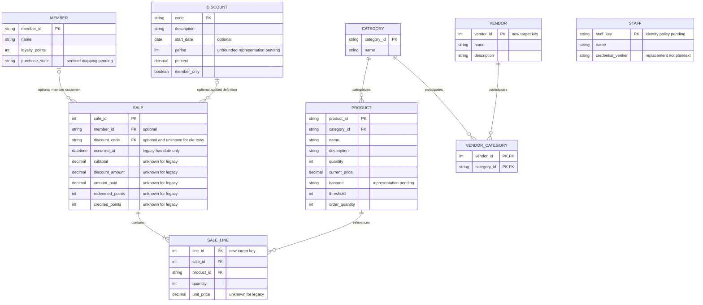

# Data architecture reconstruction

Baseline `87bee5fed6e44cf87fd91a05de42a6817ae81002`; read-only reconstruction, 2026-11-25. **Existing storage is text files, not relational tables.** The ER model below is explicitly proposed, not implemented. No migration, build, execution or test was performed.

Related: [architecture](architecture-reconstruction.md), [workflow write order](workflow-reconstruction.md), [business rules](business-rules.md), [refactoring opportunities](refactoring-opportunities.md), [inventory](../inventory/asset-inventory.md) and [risk/decision register](../inventory/reengineering-priorities.md).

## All existing .dat assets and positional record formats

The actual baseline contains **11 physical .dat files**, all under legacy/data-sample/, with **57 lines**. Runtime startup expects corresponding filenames under a writable working-directory data folder; that live folder is absent from the baseline. Filenames and case come from [StoreApplication.main()](../../legacy/src/sg/edu/nus/iss/se24_2ft/unit1/ca/StoreApplication.java). No header rows occur in the supplied samples.

| Actual file path | Lines | Fields in exact order | Reader / writer / reference meaning |
|---|---:|---|---|
| [legacy/data-sample/Category.dat](../../legacy/data-sample/Category.dat) | 5 | category ID, name | CategoryManager.load()/store(); ID resolves product/vendor category. |
| [legacy/data-sample/Products.dat](../../legacy/data-sample/Products.dat) | 10 | product ID, name, description, quantity, price, barcode, threshold, orderQuantity | ProductManager.load()/store(); category comes from ID prefix. |
| [legacy/data-sample/Members.dat](../../legacy/data-sample/Members.dat) | 11 | name, member ID, loyaltyPoint | MemberManager.load()/store(); member ID referenced by history, -1 signals first purchase. |
| [legacy/data-sample/Discounts.dat](../../legacy/data-sample/Discounts.dat) | 5 | code, description, start, period, percent, audience | DiscountManager.load()/store(); start/period may serialize ALWAYS; audience M or A. |
| [legacy/data-sample/Storekeepers.dat](../../legacy/data-sample/Storekeepers.dat) | 2 | staff name, password | StoreKeeperManager.load(), no writer found; plaintext credentials not reproduced here. |
| [legacy/data-sample/Transactions.dat](../../legacy/data-sample/Transactions.dat) | 4 | transaction ID, product ID, customer ID/PUBLIC, quantity, date | TransactionManager.load()/store(); one row per product item, not one row per whole sale. |
| [legacy/data-sample/VendorsCLO.dat](../../legacy/data-sample/VendorsCLO.dat) | 4 | vendor name, description | VendorManager.load(), filename associates CLO category. No writer found. |
| [legacy/data-sample/VendorsDIA.dat](../../legacy/data-sample/VendorsDIA.dat) | 4 | vendor name, description | Same loader; filename associates DIA category. |
| [legacy/data-sample/VendorsMUG.dat](../../legacy/data-sample/VendorsMUG.dat) | 4 | vendor name, description | Same loader; filename associates MUG category. |
| [legacy/data-sample/VendorsSNA.dat](../../legacy/data-sample/VendorsSNA.dat) | 4 | vendor name, description | Same loader; filename associates SNA category. |
| [legacy/data-sample/VendorsSTA.dat](../../legacy/data-sample/VendorsSTA.dat) | 4 | vendor name, description | Same loader; filename associates STA category. |

The four history rows represent three transaction IDs: transaction 1 includes CLO/1 and MUG/1 with the same member/date; transaction 2 is PUBLIC; transaction 3 references another member. All five vendor files have identical bytes, but each filename contributes a distinct category association. Samples therefore supply 20 category/vendor pairs using four repeated vendor names, not 20 proven distinct vendors.

### Field types, normalization and sentinels

| Data owner | Runtime representation and source evidence | Defaults / validation boundary |
|---|---|---|
| Category | [Category](../../legacy/src/sg/edu/nus/iss/se24_2ft/unit1/ca/category/Category.java) strings id/requestedId/name; [CategoryManager.load()/addCategory()/getCategory()](../../legacy/src/sg/edu/nus/iss/se24_2ft/unit1/ca/category/CategoryManager.java). | Constructor trims; load skips duplicates/non-three-character IDs; add checks blank/duplicate/length; lookup uppercases but insertion retains case. |
| Product | [Product](../../legacy/src/sg/edu/nus/iss/se24_2ft/unit1/ca/product/Product.java) string id/name/description, int quantity/barcode/threshold/orderQuantity, double price, Category reference; [ProductManager.load()](../../legacy/src/sg/edu/nus/iss/se24_2ft/unit1/ca/product/ProductManager.java). | Numeric parse fallback zero. Duplicate ID/barcode or missing category skips row; first two slash components interpreted without full grammar validation; unchecked suffix parse. |
| Member | [Member](../../legacy/src/sg/edu/nus/iss/se24_2ft/unit1/ca/customer/member/Member.java) string id/name, int loyaltyPoint; [MemberManager.load()](../../legacy/src/sg/edu/nus/iss/se24_2ft/unit1/ca/customer/member/MemberManager.java). | Trimmed requested ID/name; duplicate IDs skip; invalid stored points default -1; no database constraints. |
| Discount | [Discount](../../legacy/src/sg/edu/nus/iss/se24_2ft/unit1/ca/discount/Discount.java) string code/description, Date start, int period, double percent, boolean memberOnly; [DiscountManager.load()](../../legacy/src/sg/edu/nus/iss/se24_2ft/unit1/ca/discount/DiscountManager.java). | Code trim/uppercase; date invalid→null, duration invalid→-1, percent invalid→0; audience uppercased M means member-only, other tokens mean all. Duplicates skip by normalized code. |
| Staff | [StoreKeeper](../../legacy/src/sg/edu/nus/iss/se24_2ft/unit1/ca/storekeeper/StoreKeeper.java); [load()/login()](../../legacy/src/sg/edu/nus/iss/se24_2ft/unit1/ca/storekeeper/StoreKeeperManager.java). | Record constructor trims name/password, map insertion keys raw name; duplicate names overwrite; no password hash or staff ID foreign key. |
| Transaction/item | [Transaction](../../legacy/src/sg/edu/nus/iss/se24_2ft/unit1/ca/transaction/Transaction.java), [TransactionItem](../../legacy/src/sg/edu/nus/iss/se24_2ft/unit1/ca/transaction/TransactionItem.java), [load()](../../legacy/src/sg/edu/nus/iss/se24_2ft/unit1/ca/transaction/TransactionManager.java). | Integer transaction ID; int item quantity; ID/quantity parse fallback 0; date invalid→null. Lines grouped by ID; product/customer references require current registries. |
| Vendor | [Vendor](../../legacy/src/sg/edu/nus/iss/se24_2ft/unit1/ca/vendor/Vendor.java); [load()](../../legacy/src/sg/edu/nus/iss/se24_2ft/unit1/ca/vendor/VendorManager.java). | File pattern Vendors[A-Z]{3}.dat; category substring from filename; skip unknown category; merge by raw name map key, assume same description. Vendor constructor trims fields; no durable independent vendor ID. |

[Util.splitCsv()](../../legacy/src/sg/edu/nus/iss/se24_2ft/unit1/ca/util/Util.java) uses split(',', -1), preserving empty fields but not quoted commas/newlines. Entity toString() methods join raw fields without escaping. Short rows can trigger array-index failures; numeric defaults can hide malformed values. Dates serialize yyyy-MM-dd, losing in-memory time-of-day. No explicit schema version or per-row provenance is stored.

## Identifiers and existing relationships

| Relationship | Evidence / actual resolution | Integrity limitation |
|---|---|---|
| Product → Category | ProductManager.load() splits product ID and calls CategoryManager.getCategory(); private addProduct() sets Product.category. | Category embedded in ID, case assumptions and unchecked suffix; no foreign key. |
| Vendor ↔ Category | VendorManager.load() reads category filename, adds Category to Vendor and Vendor to category list. | Same-name merge assumes descriptions agree; removing duplicate-looking files loses associations. |
| Transaction → Customer | Transaction.customer stores Customer; Member/PublicCustomer implement getId(); TransactionItem.toString() falls back to PUBLIC. | Loader reverses PUBLIC/member branch; actual stored member token must be reconciled from raw input. |
| Transaction → items → Product | Transaction owns list/map keyed by product ID; item references Product and parent Transaction. | Repeated product rows aggregate quantities; object aliases use current product state/prices. |
| Discount → Transaction | Transaction.discount references selected definition in memory. | No applied code/percent/value is written to history; no historical discount reference can be imported as fact. |
| Staff login → sale | Startup requires login but passes no staff identity to TransactionManager/Transaction. | No captured cashier→sale relationship; do not invent one in existing model. |

## In-memory ownership and exposed state

| Owner / exact source above | Owned maps/lists/state | Consumers / alias implications |
|---|---|---|
| CategoryManager | categoryMap by ID; categoryList; cached tableModel; filename | Product/vendor loading, category/report views; getCategoryList() exposes internal list. |
| ProductManager | productMap by ID, barcodeMap by int, productList, understockProductList, maxSubIdMap by category; two cached models; categoryManager | Same Product objects shared by lists/maps/basket/report. getProductList() exposes list; stock changes mutate referenced objects. |
| MemberManager | memberMap, memberList, tableModel, filename | Checkout/discount/loyalty/report use same Member objects; getMemberList() copies list but not elements. |
| DiscountManager | discountMap by normalized code, discountList, tableModel, filename | Checkout selects shared Discount; getDiscountList() exposes list; dates are mutable references. |
| StoreKeeperManager | storeKeeperMap by raw staff name, filename | Login only; no sale cashier state. |
| VendorManager / Vendor | vendorMap by raw name; vendorListMap by category; each Vendor.categoryList | Shared Vendor per name across lists; manager returns internal per-category list; Vendor getter copies list shallowly. |
| TransactionManager | transactionMap by integer ID, transactionList, flattened transactionItemList, maxId, cached model, product/member managers | Flattened list shares item references with parent transactions; later distinct load lines omitted from flattened list. |
| Transaction | item map by product ID, item list, cached model, customer/date/discount, subtotal, redemption/payment/credit, nullable id | Basket/payment/receipt share one instance; getTransactionItemList() exposes list; setter lock after ID is not immutable snapshot. |
| Util / PublicCustomer / Printer | public mutable DATE_FORMAT object; shared effectively read-only public identity; mutable static printer count | Different forms of state: constants/public identity should not be equated with uncontrolled mutable formatter/list access. |

Field declarations and getters in the linked owner classes establish these relationships; no hidden DAO/repository owner is assumed.

## Read/write methods and order

| Operation | File access and ordering | Source methods |
|---|---|---|
| Startup | Staff read before login; after success category → vendor directory/files → product → member → discount → transaction reads. | StoreApplication.main(); each manager constructor/load(). |
| Category/product/member/discount add | In-memory list/map mutation → table notification → rewrite corresponding complete file. | addCategory(), addProduct(), addMember(), addDiscount() → store(). |
| Member debit/credit | Member mutation → table cell event → member file rewrite; zero debit returns before write. | MemberManager.debitLoyaltyPoint()/creditLoyaltyPoint()/store(). |
| Sale stock change | Product mutation → table/understock events → product file rewrite, once per item. | ProductManager.deductQuantity()/store(). |
| Replenishment | Restock selections → rebuild understock list → table data events → product file rewrite. | ProductManager.generatePurchaseOrder()/store(). |
| Sale completion | Coverage validation → member debit write if nonzero → member credit write → per-product writes → assign ID/list/map/report events → transaction file rewrite. | TransactionManager.addTransaction(); member/product operations above. |
| History store | Transaction list encounter order; each transaction's lines sorted lexically by product ID, then flattened to text. | TransactionManager.store(); Transaction.toStringStream(); TransactionItem.toString(). |
| Other stores | Category/product/member sorted by IDs; discount sorted by code. All use Files.write on full derived streams, not append. | Respective store() and entity toString(). |
| Reports / receipt | In-memory reads/rendering; receipt also writes System.out, not a .dat file. | ReportPanel and ReceiptDialog/Printer. |

Store methods catch/print IOException; they do not restore in-memory state, undo other writes or return a durable outcome. File locking, multi-process sequence allocation, atomic multi-file commit, backup recovery and rollback are not implemented in these paths. A failed/partial load followed by rewrite can lose skipped rows from derived output. No such failure was executed; these are source-supported risks.

### History reconstruction specifics

TransactionManager.load() groups by integer ID, uses first row's date/customer, adds lines with isLoading=true (no stock availability check/replay), then assigns IDs after reading. Distinct later products do not enter flattened report list; same-product lines can update a shared existing item. A group may survive with invalid/zero valid items after caught product errors.

TransactionManager.store() relies on transactionList encounter order rather than sorting chronologically. Empty in-memory transactions emit no rows; maxId is reconstructed from persisted row IDs, not a separate sequence. There is no stable independent line ID in the text format.

## Test fixtures versus physical sample data

[legacy/test/util/TestUtil.java](../../legacy/test/util/TestUtil.java) embeds strings for eight fixture filenames (category, product, member, discount, transaction, staff and two vendor files) and writes them to shared relative test filenames. These generated fixture files are not additional physical baseline .dat assets.

Fixtures are not identical to shipped samples: e.g. the helper adds an ALWAYS PUBLIC_DISCOUNT definition used by [DiscountManagerTest](../../legacy/test/sg/edu/nus/iss/se24_2ft/unit1/ca/DiscountManagerTest.java), while the physical Discounts.dat has five definitions. Tests also use differing categories/products. Do not infer public-discount availability or data counts in the shipped system from helper-only examples. No fixture writes were executed.

## Proposed relational entities and relationships — not implemented

This is a **logical proposal for later review**, derived from current entities and recorded/in-memory sale state. No engine, DDL, ORM, migration or database library exists as a result of this task. Exact types/precision/keys, date policy and staff credential migration remain decisions.

| Proposed entity | Source basis / proposed mapping | Unknowns and constraints to decide |
|---|---|---|
| CATEGORY | Category ID/name; one category per Product. | Canonical case/valid ID rules and source-key preservation. |
| PRODUCT | Product fields, explicit category reference; unique accepted barcode. | Preserve source ID, stock/reorder meaning; barcode numeric versus opaque-text representation; money precision. |
| MEMBER | Member ID/name/balance; separate first-purchase state rather than overloading -1 if approved. | Sentinel conversion requires an explicit rule, not subtracting one from points. |
| SALE | Transaction ID/date, optional member, optional selected discount, proposed financial/payment/redemption/credit snapshots. | Public sale can have no MEMBER. Old financial fields are unavailable, so nullable/explicit unknown provenance is required; selected discount cannot be fabricated. |
| SALE_LINE | Parent sale, referenced product, quantity; proposed unit-price snapshot for new sales. | Legacy product-per-sale aggregation; generated line key is new, not a recovered source ID. Old original price must remain unknown rather than copied as historical fact. |
| DISCOUNT | Definition fields/code/member-only flag; optional association for newly captured applied discount. | Keep future applied financial snapshot independent of later definition edits; historical association absent. |
| VENDOR | Vendor identity/name/description. | Proposed independent key; same-name conflicts require resolution. |
| VENDOR_CATEGORY | Explicit association derived from each vendor filename/category. | Preserve all pairs; proposed composite association key, no “duplicate file” deletion. |
| STAFF | Name and proposed credential-verifier representation replacing plaintext. | No existing sale staff reference: keep disconnected unless a new requirement is explicitly approved. |

### Proposed ER diagram

Cardinalities below describe the **proposed accepted model**, not current file constraints. It proposes at least one line for a valid sale (matching the UI intent), although the legacy manager API permits an empty transaction. New financial snapshot attributes are proposed; old values may be unknown. MEMBER/DISCOUNT association with SALE is optional. STAFF is intentionally unlinked because no cashier sale reference is captured.

### Migration decisions and acceptance boundaries

- Reconcile raw transaction/member references and all four sample transaction lines before using loader-derived reports as an oracle.
- Preserve source IDs/raw records and classify rejects/conflicts. Do not silently drop rows to satisfy new keys.
- Keep unknown historical amounts/discounts/payments/points/time-of-day distinguishable from zero, none or a manufactured midnight timestamp claim.
- Preserve all vendor/category associations; decide independent vendor identity before merging conflicting names.
- Define atomic sale/member/stock updates and failure/retry semantics with the service owner before implementing the adapter.
- Approve monetary precision, dates, first-purchase state, credentials and valid-input rules. A proposed schema cannot settle those requirements itself.
- Decide source versus target line aggregation and delete/update retention rules; no new operational CRUD or cashier link is assumed.
- No migration or relational implementation is claimed complete. Hamna owns data/persistence/integration quality, with Iman supplying business contracts and Shared validating equivalence.
